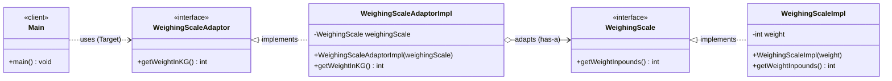

# Adapter Design Pattern — Class Diagram

Object adapter: `WeighingScaleAdaptorImpl` implements the Target interface and wraps the Adaptee (pounds) to expose kilograms.

## Legend

| Arrow | Meaning |
|---|---|
| `..>` | dependency — client uses the Target interface only |
| `<\|..` | realization — class implements interface |
| `o-->` | aggregation — adapter holds the adaptee (injected via constructor) |
