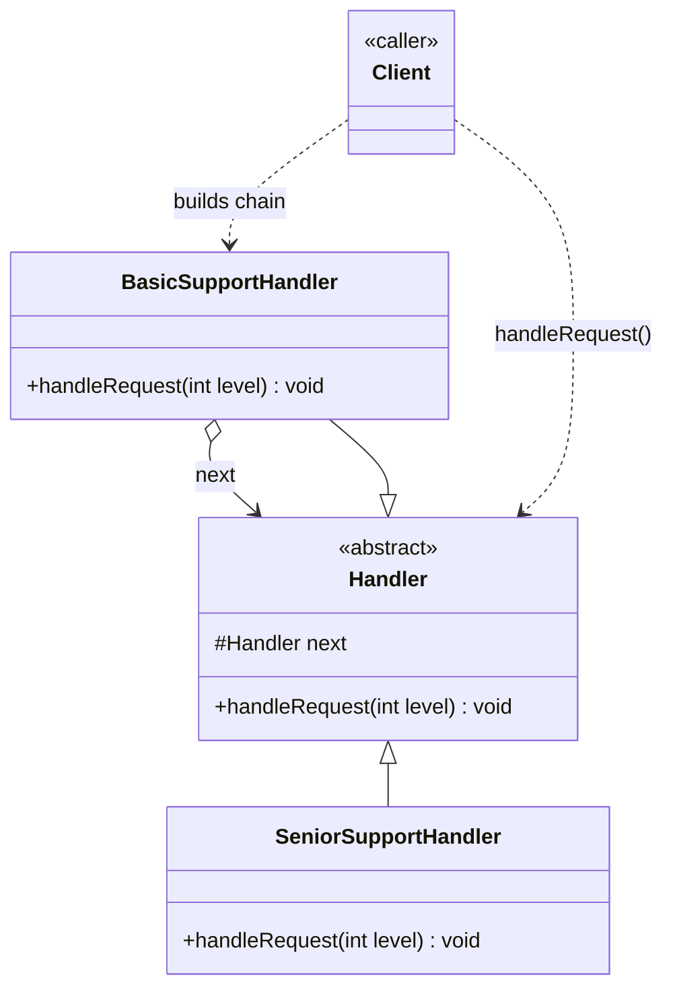

# Chain of Responsibility

Behavioral pattern: **passes a request along a chain of handlers** until one of them handles it, instead of binding the request to a single receiver up front. See [class-diagram.md](./class-diagram.md).

## The one-sentence mental model

> "Give the request to the first handler; if it can't deal with it, it passes the buck to the next one — the sender never needs to know who finally handles it."

Think of it like a support ticket escalation: L1 support tries first, escalates to L2 if it's beyond their authority, L2 escalates to L3, and so on. The customer never files the ticket with a specific tier — they just submit it.

## What it does

- Each `Handler` decides either to **process the request** or **forward it** to the next handler in the chain.
- Handlers are **linked in a chain** (usually via a `next` reference), and the sender only ever talks to the first one.
- **Decouples sender from receiver** — the sender doesn't know, and doesn't need to know, which handler (if any) ends up processing the request.
- The chain's length and order can be **assembled dynamically**, letting you add/remove/reorder handlers without touching the sender's code.

## When to use

- More than one object may handle a request, and the handler **isn't known in advance** — it should be determined at runtime.
- You want to issue a request to one of several objects **without specifying the receiver explicitly**.
- The **set of handlers should be configurable** — added, removed, or reordered independently of the client.
- Common fits: middleware pipelines, event bubbling, approval/escalation workflows, validation pipelines.

## When NOT to use

- There's exactly one fixed receiver for a request — just call it directly.
- Every handler in the chain must always run (not conditionally stop) — that's closer to a plain pipeline/decorator than Chain of Responsibility.
- A request could legitimately need **no handler in the chain** to catch it — make sure that's an acceptable outcome, or add a default/terminal handler.

## How to use (small example)

```java
// Handler — shared linking + forwarding logic
abstract class Handler {
    protected Handler next;

    Handler(Handler next) {
        this.next = next;
    }

    abstract void handleRequest(int level);

    protected void forward(int level) {
        if (next != null) {
            next.handleRequest(level);
        }
    }
}

// ConcreteHandler — decides "mine to handle" vs. "pass it on"
class BasicSupportHandler extends Handler {
    BasicSupportHandler(Handler next) { super(next); }

    void handleRequest(int level) {
        if (level <= 1) {
            System.out.println("Resolved by L1 support");
            return;
        }
        forward(level);
    }
}

class SeniorSupportHandler extends Handler {
    SeniorSupportHandler(Handler next) { super(next); }

    void handleRequest(int level) {
        if (level <= 2) {
            System.out.println("Resolved by L2 support");
            return;
        }
        forward(level);
    }
}

// Client — builds the chain, then just talks to the first link
Handler chain = new BasicSupportHandler(new SeniorSupportHandler(null));
chain.handleRequest(2); // "Resolved by L2 support"
```

Key idiom: `BasicSupportHandler` never mentions `SeniorSupportHandler` by name in its handling logic — it only calls `forward()`, which delegates to whatever `next` happens to be. Swapping or extending the chain means changing how it's built, not how any handler behaves.

## Diagram



```
Client -> chain.handleRequest(2)
BasicSupportHandler.handleRequest(2) -> level > 1 -> forward(2)
SeniorSupportHandler.handleRequest(2) -> level <= 2 -> "Resolved by L2 support"
```

## Roles (GoF)

| Role | Responsibility |
|---|---|
| **Handler** | Abstract base declaring `handleRequest()` and holding the `next` reference + forwarding logic |
| **ConcreteHandler** | Decides whether to handle the request or forward it to `next` |
| **Client** | Builds the chain (wires handlers together) and submits the request to the first handler |

## Chain of Responsibility vs. look-alikes

| Pattern | Intent |
|---|---|
| **Chain of Responsibility** | Pass a request along a chain of handlers until one handles it; receiver isn't fixed |
| **Command** | Wrap a request as an object bound to one specific `Receiver` up front, so it can be queued/logged/undone |
| **Decorator** | Every wrapper runs and adds behavior around the call; it doesn't stop the chain or pick "who handles it" |
| **Observer** | Broadcasts a notification to *all* interested parties; doesn't stop at the first one that "handles" it |
| **Mediator** | Centralizes communication between objects through one hub; Chain of Responsibility has no central coordinator, just sequential delegation |

## Real-world examples

- Servlet filters / HTTP middleware pipelines (Express, ASP.NET) — each filter can handle, modify, or pass the request onward
- Java's exception handling (`try`/`catch` propagation up the call stack) — each frame either catches or rethrows
- GUI event bubbling (DOM event propagation) — an event bubbles up through ancestor elements until something calls `stopPropagation()`
- Logging frameworks (`java.util.logging.Logger` parent handlers) — a log record climbs the logger hierarchy until a handler processes it

## Scaling this pattern

- **Dynamic chain assembly**: a hand-wired `new A(new B(new C(null)))` doesn't scale when handlers vary per request type/tenant/config — introduce a `HandlerChainFactory`/registry that builds the right chain (and order) per lookup key, so the client only ever depends on the abstract `Handler`.
- **Per-call resolution instead of per-construction binding**: in a static chain, `next` is fixed at construction. At scale, a handler may need to resolve its successor per call (e.g., based on request attributes) rather than binding to one collaborator up front — resolve `next` via the registry inside `handleRequest()` instead of storing it as a field.
- **Thread-safety**: if handlers are shared/reused across concurrent requests (common in server pipelines), any mutable state on a handler must be synchronized or, better, kept out of the handler entirely and passed through the request/context object instead.
- **Beyond a single process**: when handling steps span services rather than one JVM, the in-memory `next` reference becomes a message passed through a broker/event bus/pipeline (e.g., a Kafka topic per stage, or an API gateway chaining calls to downstream services) — each stage still decides "handle or forward," just across a network boundary instead of a method call.
