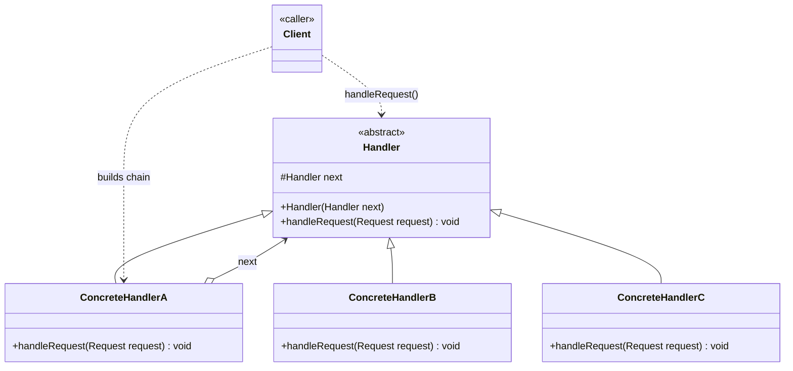
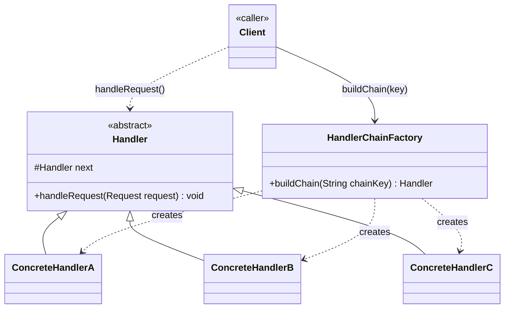

# Chain of Responsibility — Class Diagram

A request travels along a chain of `Handler` objects; each one either handles it or forwards it to the next, and the sender never knows which handler ends up processing it.

## Legend

| Arrow | Meaning |
|---|---|
| `<\|--` | inheritance — written `Base <\|-- Derived`; the base class goes first (parent role) so it renders above the classes that extend it |
| `o-->` | aggregation — a handler holds a reference to the next handler but doesn't own its lifecycle |
| `..>` | dependency — uses / instantiates |

**Layout convention**: relationship arrows are always written *parent/base first* (`Base <|-- Derived`), never child-first. This is what makes Mermaid rank the abstract `Handler` above its concrete subclasses in a `TB` diagram instead of scattering them left/right/below inconsistently.

**Why an abstract class instead of an interface**: every `Handler` needs to *store* the `next` reference and implement the *same* forwarding logic (`if next != null, delegate`). An interface can't hold that shared field or method body — each concrete handler would have to reimplement forwarding itself, which is exactly the boilerplate the pattern exists to remove. The abstract class gives every link in the chain identical plumbing for free, leaving only `handleRequest()`'s actual business rule to vary per subclass.

## Scaling: many instances

A single hard-coded chain (`new A(new B(new C(null)))`) doesn't scale when the set/order of handlers must vary per request type, tenant, or environment. At that point the chain is assembled dynamically instead of hand-wired:

`HandlerChainFactory` looks up which concrete handlers apply for a given key (request type, tenant config, feature flags) and wires them in the right order at runtime — the client only ever depends on `Handler`, never on which concrete chain it got back.
