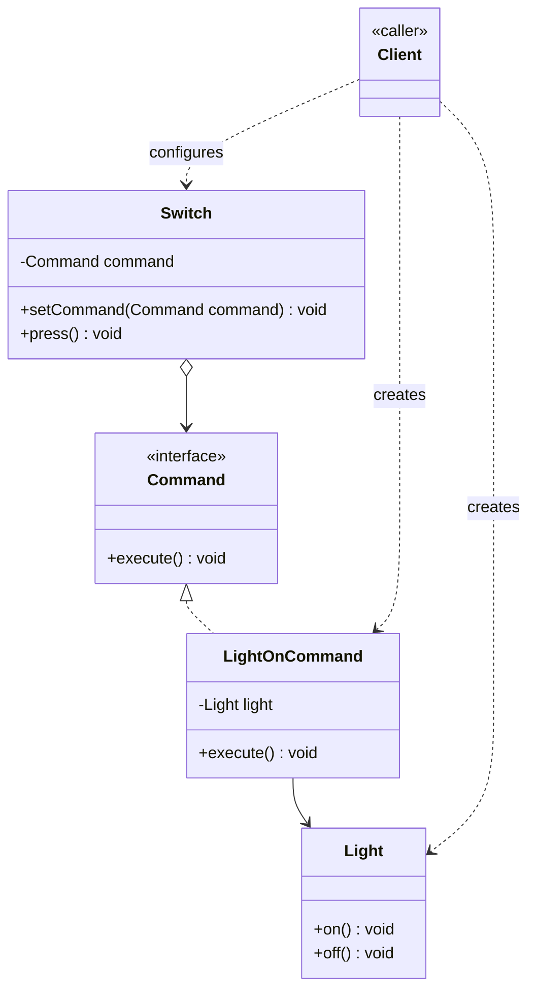

# Command Design Pattern

Behavioral pattern: **turns a request into a stand-alone object** that carries everything needed to perform an action — the method to call, the receiver to call it on, and any arguments. See [class-diagram.md](./class-diagram.md).

## The one-sentence mental model

> "Wrap 'do this action' into an object, so the caller can hand it around, queue it, log it, or undo it without knowing what it actually does."

Think of it like a restaurant order slip: the waiter (`Invoker`) doesn't cook — they just carry the slip (`Command`) to the kitchen (`Receiver`). The waiter's job never changes even if the kitchen's menu does.

## What it does

- Encapsulates a request (method + receiver + args) as an object implementing a common `Command` interface (usually just `execute()`).
- Decouples the object that **invokes** an operation (`Invoker`) from the object that **knows how to perform** it (`Receiver`).
- Because the request is now an object, it can be **stored, queued, logged, passed around, or reversed** (`undo()`) like any other value.
- Multiple different `ConcreteCommand`s can wrap the same `Receiver`'s different methods, or the same method with different bound arguments.

## When to use

- You need to **parameterize** an object with an action to perform later (callbacks, menu items, button clicks).
- You want to **queue, schedule, or log** requests, or support **undo/redo**.
- You want to **decouple** the sender of a request from the object that handles it.
- You need to build requests from primitive commands (macro/composite commands).

## When NOT to use

- The action is a single, simple method call with no need for queuing, undo, or decoupling — just call the method directly.
- Wrapping every action in a class adds more boilerplate than value for a small, static set of operations.

## How to use (small example)

```java
// Command — the contract
interface Command {
    void execute();
}

// Receiver — knows how to actually do the work
class Light {
    void on()  { System.out.println("Light ON"); }
    void off() { System.out.println("Light OFF"); }
}

// ConcreteCommand — binds one receiver + one action
class LightOnCommand implements Command {
    private final Light light;
    LightOnCommand(Light light) { this.light = light; }
    @Override public void execute() { light.on(); }
}

class LightOffCommand implements Command {
    private final Light light;
    LightOffCommand(Light light) { this.light = light; }
    @Override public void execute() { light.off(); }
}

// Invoker — holds a command, doesn't know what it does
class Switch {
    private Command command;
    void setCommand(Command command) { this.command = command; }
    void press() { command.execute(); }
}

// Client
Light light = new Light();
Switch toggle = new Switch();

toggle.setCommand(new LightOnCommand(light));
toggle.press();               // Light ON

toggle.setCommand(new LightOffCommand(light));
toggle.press();               // Light OFF
```

Key idiom: `Switch` (invoker) never mentions `Light` or `LightOnCommand` by name in its logic — it only calls `command.execute()`. Swapping behavior means swapping which `Command` object it holds.

## Diagram



```
Client -> switch.setCommand(new LightOnCommand(light))
Client -> switch.press() -> command.execute() -> light.on()
```

## Roles (GoF)

| Role | Responsibility |
|---|---|
| **Command** | Interface declaring `execute()` (the request contract) |
| **ConcreteCommand** | Binds a `Receiver` + action (+ args) and implements `execute()` |
| **Receiver** | Knows the actual business logic behind the action |
| **Invoker** | Holds a `Command` and triggers `execute()`, without knowing the receiver |
| **Client** | Creates `ConcreteCommand`s, wires them to `Receiver`s, and hands them to the `Invoker` |

## Command vs. look-alikes

| Pattern | Intent |
|---|---|
| **Command** | Wrap a request as an object so it can be passed, queued, logged, or undone |
| **Strategy** | Wrap an *algorithm* as an object so it's interchangeable; no notion of undo/queuing/logging |
| **Chain of Responsibility** | Pass a request along a chain of handlers until one handles it, instead of binding it to a single receiver up front |
| **Observer** | Notify many dependents of a state change; not about invoking a single deferred action |
| **Memento** | Captures object *state* for later restore; Command's undo re-runs an inverse action, it doesn't snapshot state |

## Real-world examples

- `java.lang.Runnable` / `java.util.concurrent.Callable` — a unit of work handed to a thread/executor that doesn't know what the work does
- GUI toolkits (Swing `Action`, JavaFX `EventHandler`) — button clicks and menu items wrap an action object
- Undo/redo stacks in editors — each edit is a `Command` with `execute()`/`undo()`
- Job queues / task schedulers — queued `Command` objects executed later, possibly on a different thread
