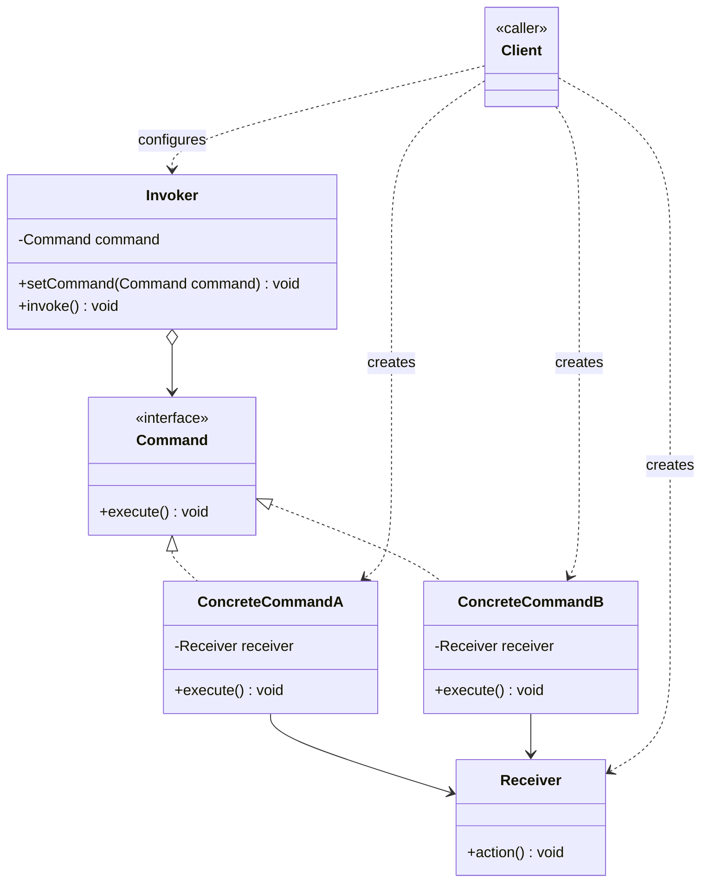

# Command Design Pattern — Class Diagram

`Invoker` holds a `Command` reference and calls `execute()` without knowing which action or `Receiver` is behind it. Each `ConcreteCommand` binds one `Receiver` instance to one action, turning a request into a standalone object.

## Legend

| Arrow | Meaning |
|---|---|
| `<\|..` | realization — written `Interface <\|.. Implementation`; the interface goes first (parent role) so it renders above the classes that implement it |
| `-->` | association — holds a reference to and calls |
| `o-->` | aggregation — invoker holds a command but doesn't own its lifecycle |
| `..>` | dependency — uses / instantiates |

**Layout convention**: in a UML class diagram, relationship arrows are always written *parent/interface first* (`Interface <|.. Implementation`, `Base <|-- Derived`), never child-first. This is what makes Mermaid rank the interface/base class above its implementers in a `TB` diagram instead of scattering them left/right/below inconsistently.

The invoker never names `ConcreteCommandA`/`B` or `Receiver` — it only knows `Command.execute()`. That's what lets you queue commands, log them, or undo them without the invoker's code ever changing.
