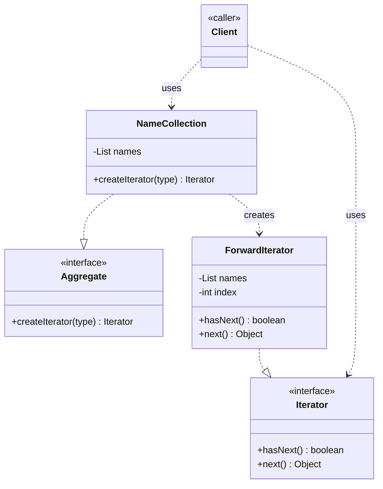

# Iterator Design Pattern

Behavioral pattern: gives you a way to **walk through the elements of a collection one at a time, without exposing how that collection is stored internally** (array? list? tree? doesn't matter to the caller). See [class-diagram.md](./class-diagram.md).

## The one-sentence mental model

> "Give me something with `hasNext()` / `next()`, and I don't care what's underneath it."

Think of it like a TV remote: you press "next channel" without knowing whether channels are stored as a list, a linked list, or fetched from a database. The remote (`Iterator`) hides that.

## What it does

- Separates **traversal logic** (how to move from one element to the next) from the **collection itself** (how elements are stored).
- The collection (`Aggregate`) doesn't loop over itself — it just hands out an `Iterator` object whose job is to loop.
- Multiple iterators can traverse the **same collection at the same time**, each with its own independent position/cursor.
- You can have **many traversal strategies** over one collection (forward, shuffled, filtered) without changing the collection's code — just write a new `Iterator` implementation.

## Why it feels confusing at first

It feels like "just a for-loop wrapped in a class," and that intuition is basically correct — the trick is realizing *why* you'd bother:
- Once traversal is its own object, the collection's internal data structure can change (array → linked list → tree) and client loops (`while (it.hasNext())`) don't care.
- You can have several *different kinds* of traversal (e.g. only-favorites, shuffled, reverse) over the exact same data, chosen at runtime by a string/enum — without adding new loop logic to the collection class.
- It's also why Java's `for (String s : list)` works on almost anything — under the hood, `List`, `Set`, etc. all implement `Iterable`, which just means "I can give you an `Iterator`."

## When to use

- You need to traverse a collection **without exposing its internal structure** (array vs. linked list vs. tree).
- You want to support **multiple simultaneous traversals** of the same collection, each independent.
- You want **multiple ways to traverse** the same data (e.g. sorted, filtered, reversed) chosen at runtime.
- You're building a **custom collection type** and want it to work with `for-each` loops.

## When NOT to use

- The collection is simple and only ever traversed one way — just use a plain loop or index.
- You're on a language/library where the built-in iterator (`java.util.Iterator`, Python generators, etc.) already covers your need — don't reinvent it.

## How to use (small example)

```java
// Iterator — the "remote control" interface
interface Iterator {
    boolean hasNext();
    Object next();
}

// Aggregate — the collection's factory-method contract
interface Aggregate {
    Iterator createIterator(String type);
}

// ConcreteAggregate — holds the real data
class NameCollection implements Aggregate {
    private List<String> names = new ArrayList<>();

    void add(String name) { names.add(name); }

    @Override
    public Iterator createIterator(String type) {
        switch (type) {
            case "FORWARD": return new ForwardIterator(names);
            case "SHUFFLE": return new ShuffleIterator(names);
            default: throw new IllegalArgumentException("Unknown type: " + type);
        }
    }
}

// ConcreteIterator — owns its own cursor
class ForwardIterator implements Iterator {
    private final List<String> names;
    private int index = 0;

    ForwardIterator(List<String> names) { this.names = names; }

    @Override public boolean hasNext() { return index < names.size(); }
    @Override public Object next()     { return names.get(index++); }
}

// Client
NameCollection collection = new NameCollection();
collection.add("Alice");
collection.add("Bob");

Iterator it = collection.createIterator("FORWARD");
while (it.hasNext()) {
    System.out.println(it.next());
}
```

Key idiom: the client only ever talks to the `Iterator` interface (`hasNext`/`next`) and the `Aggregate` interface (`createIterator`). It never types `ForwardIterator` or peeks at `List<String>` directly.

## Diagram



```
Client -> collection.createIterator("FORWARD") -> new ForwardIterator(names) -> Iterator
Client -> it.hasNext() -> true/false
Client -> it.next()    -> element, cursor advances
```

## Roles (GoF)

| Role | Responsibility |
|---|---|
| **Iterator** | Interface declaring `hasNext()` / `next()` (traversal contract) |
| **ConcreteIterator** | Implements traversal + owns the cursor/position state |
| **Aggregate** | Interface declaring `createIterator()` (the factory method for iterators) |
| **ConcreteAggregate** | The actual collection; knows which `ConcreteIterator` to hand out |
| **Client** | Uses `Iterator`/`Aggregate` only through their interfaces |

## Iterator vs. look-alikes

| Pattern | Intent |
|---|---|
| **Iterator** | Traverse a collection's elements sequentially, one at a time, without exposing storage |
| **Factory Method** | `createIterator()` here *is* a Factory Method — used to produce the right iterator, but the pattern's real goal is the traversal contract, not object creation |
| **Composite** | Often paired with Iterator (e.g. traversing a tree of `Composite`/`Leaf` nodes), but Composite is about part-whole structure, not traversal |
| **Visitor** | Also "operates on elements of a structure," but Visitor performs an *operation* on each element; Iterator just exposes *access* to each element |

## Real-world examples

- `java.util.Iterator` / `Iterable` — every `for (x : collection)` loop in Java
- `java.sql.ResultSet` — `next()` moves the cursor row by row, hiding the DB driver internals
- Python generators / `__iter__` + `__next__` protocol
- `java.util.Scanner` — `hasNext()` / `next()` over input tokens
