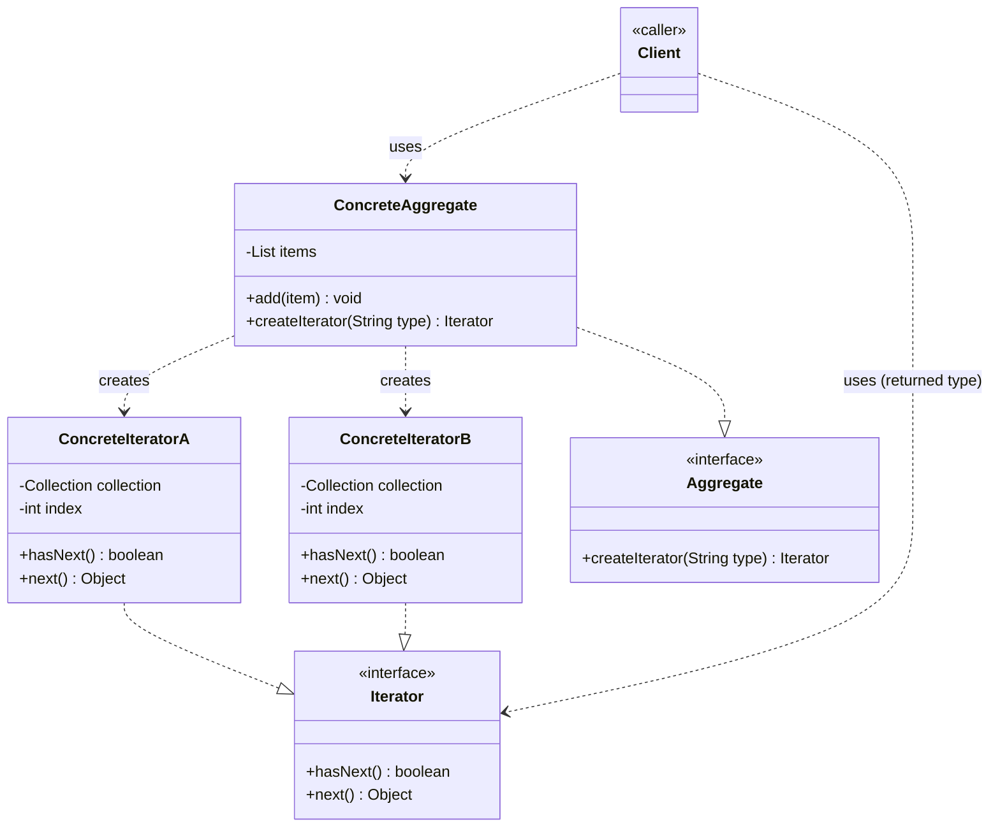

# Iterator Design Pattern — Class Diagram

`Aggregate` exposes a factory method that hands out an `Iterator` without revealing whether the collection is a list, array, tree, etc. Each `ConcreteIterator` keeps its own cursor/traversal state, so the same collection can be walked several different ways at once.

## Legend

| Arrow | Meaning |
|---|---|
| `..\|>` | realization — implements an interface |
| `..>` | dependency — uses / instantiates |

The client only ever holds an `Iterator` reference and a `ConcreteAggregate` reference — it never sees `ConcreteIteratorA`/`B` by name. That's the whole point: swapping traversal strategy (`"SIMPLE"`, `"SHUFFLE"`, `"FAVORITE"`, ...) doesn't change a single line of client code.
