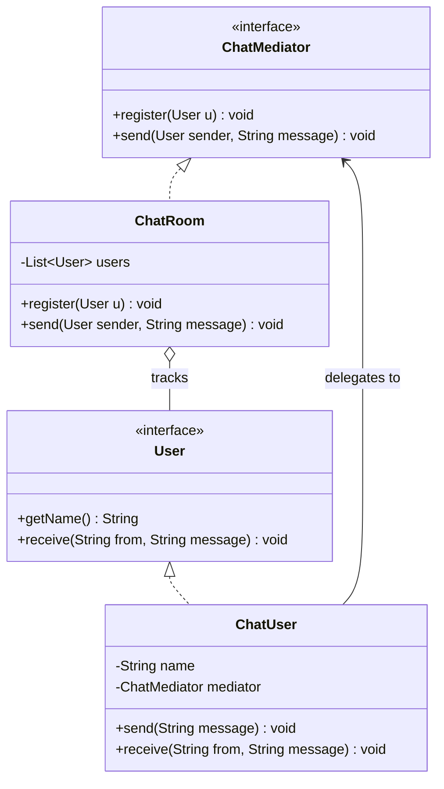

# Mediator Design Pattern

Behavioral pattern: **defines an object that encapsulates how a set of other objects interact**, so those objects don't reference each other directly. See [class-diagram.md](./class-diagram.md).

## The one-sentence mental model

> "Colleagues don't talk to each other — they talk to the mediator, and the mediator decides who hears what."

Think of an air traffic control tower: planes don't coordinate directly with each other, they all talk to the tower, and the tower decides routing. Remove the tower and every plane would need a direct line to every other plane.

## What it does

- Pulls the interaction/communication logic **out of the participants** and into one central `Mediator` object.
- Each `Colleague` only holds a reference to the `Mediator`, never to other colleagues — the mediator holds references to all of them.
- Adding a new colleague type means implementing the `Colleague` interface and registering it with the mediator — existing colleagues don't change.
- Turns an N×N mesh of direct object relationships into a hub-and-spoke: N relationships to the mediator instead of N² between colleagues.

## When to use

- A group of objects communicate in complex, tangled ways and you want to untangle that into one place.
- You want to **reuse a colleague object** in a different context without dragging along its ties to specific other objects.
- Adding a new participant currently means touching every existing participant's code — a sign communication logic is scattered instead of centralized.

## When NOT to use

- Only two objects interact — a direct reference is simpler and a mediator adds indirection for no benefit.
- The mediator itself risks becoming a god object holding all the business logic; if it grows unbounded, consider splitting responsibilities (e.g. Observer for simple broadcast, or dedicated services).

## How to use (small example)

```java
// Mediator — the coordination contract
interface ChatMediator {
    void register(User user);
    void send(User sender, String message);
}

// ConcreteMediator — owns the participant list, routes messages
class ChatRoom implements ChatMediator {
    private final List<User> users = new ArrayList<>();

    public void register(User user) { users.add(user); }

    public void send(User sender, String message) {
        for (User u : users) {
            if (u != sender) u.receive(sender.getName(), message);
        }
    }
}

// Colleague — the participant contract
interface User {
    String getName();
    void receive(String from, String message);
}

// ConcreteColleague — only knows the mediator, never other users
class ChatUser implements User {
    private final String name;
    private final ChatMediator mediator;

    ChatUser(String name, ChatMediator mediator) {
        this.name = name;
        this.mediator = mediator;
    }

    public String getName() { return name; }

    public void send(String message) { mediator.send(this, message); }

    @Override
    public void receive(String from, String message) {
        System.out.println(name + " got \"" + message + "\" from " + from);
    }
}

// Client
ChatMediator room = new ChatRoom();
User alice = new ChatUser("Alice", room);
User bob = new ChatUser("Bob", room);
room.register(alice);
room.register(bob);

((ChatUser) alice).send("hi Bob!");
```

Key idiom: `ChatUser` never holds a reference to another `ChatUser` — only to `ChatMediator`. `ChatRoom` is the only class that knows about every participant.

## Diagram



```
Alice.send("hi Bob!") -> mediator.send(Alice, "hi Bob!") -> for each other user: user.receive("Alice", "hi Bob!")
```

## Roles (GoF)

| Role | Responsibility |
|---|---|
| **Mediator** | Interface declaring how colleagues register and communicate |
| **ConcreteMediator** | Holds references to all colleagues; implements the actual routing/coordination logic |
| **Colleague** | Interface a participant implements to be coordinated by a mediator |
| **ConcreteColleague** | A participant; holds a reference to the mediator, never to other colleagues |

## Mediator vs. look-alikes

| Pattern | Intent |
|---|---|
| **Mediator** | Centralizes *how a group of objects interact* — nobody talks directly to anybody else |
| **Observer** | One subject broadcasts state changes to many subscribers; subscribers don't send messages back through the subject to each other |
| **Facade** | Simplifies a *one-directional* call into a subsystem; doesn't manage many-to-many communication between peers |
| **Command** | Encapsulates a single request as an object; doesn't coordinate multiple participants talking to each other |

## Real-world examples

- GUI frameworks: a dialog box acting as mediator between its buttons/checkboxes/text fields (widgets don't reference each other, just the dialog)
- Chat rooms / message brokers: participants publish to a channel, never to each other directly
- Air traffic control tower coordinating planes
- `java.util.concurrent.ExecutorService` mediating between submitted tasks and worker threads

## Scaling this pattern

The textbook shape is **one mediator, one group, wired by hand**. LLD interviews push past that with "now support many rooms/auctions/lobbies running at once" — here's what generally changes:

- **Mediator becomes per-context, not a singleton.** Each independent group (chat room, auction, game lobby) gets its own `ConcreteMediator` instance holding only that group's colleagues and state — a global mediator would leak state between unrelated groups.
- **A registry/factory replaces manual wiring.** A `MediatorRegistry` (or `MediatorFactory`) creates a mediator per context id and looks it up later (`Map<contextId, Mediator>`), so the client doesn't `new` and pass mediators around by hand as the number of groups grows.
- **Colleagues stop binding to one mediator at construction.** A participant that's active in several groups at once (a user in multiple chat rooms, a bidder in multiple auctions) can't hold a single fixed `Mediator` field — it holds a reference to the registry instead, and resolves the target mediator per call (`send(contextId, event)`).
- **Concurrency lands inside the mediator, not the registry.** The mediator is the one mutating shared state on every call (a running total, a highest bid, a member list); once multiple threads call in concurrently, that's where locking/synchronization or an atomic compare-and-set belongs — a naive check-then-set race is the classic bug here.
- **Past a single process, the mediator becomes distributed.** When one JVM can no longer hold every context in memory, the direct object reference is typically replaced by a message broker / event bus (a topic per context) — colleagues publish/subscribe instead of calling a method on a shared object, but the same "nobody talks directly to anybody else" guarantee still holds, just across machines instead of within one.
