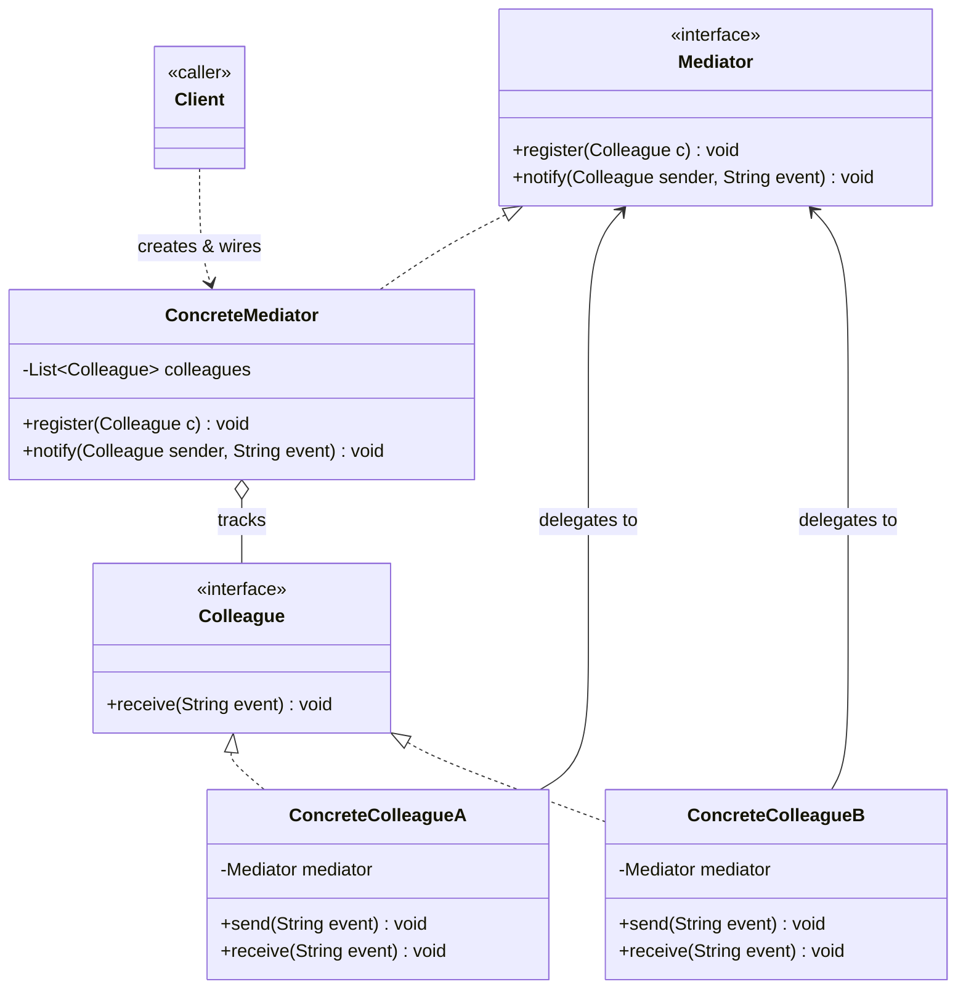
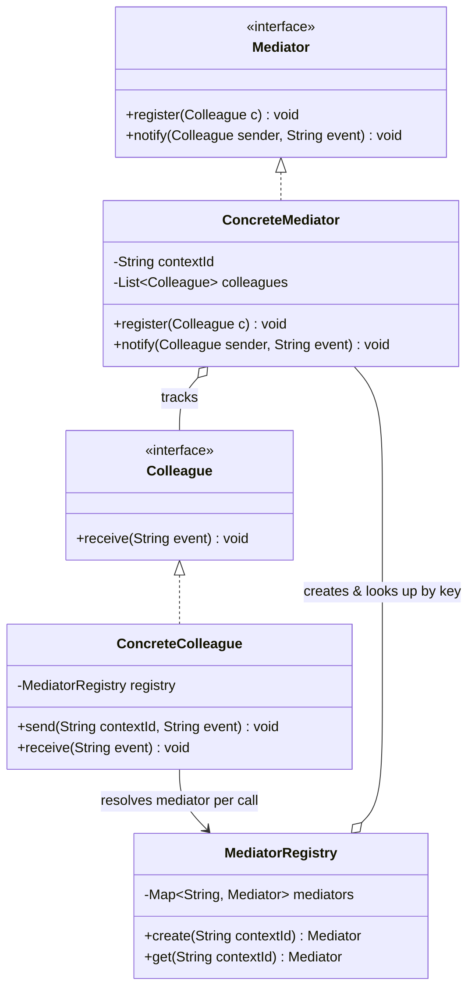

# Mediator Design Pattern — Class Diagram

A `Mediator` centralizes how a set of `Colleague` objects communicate — colleagues never reference each other directly, only the mediator, which decides how to route interactions between them.

## Legend

| Arrow | Meaning |
|---|---|
| `<\|..` | realization — implements an interface |
| `..>` | dependency — uses / instantiates |
| `o--` | aggregation — mediator holds references to colleagues it doesn't own exclusively |
| `-->` | association — colleague holds a reference to the mediator |

Interfaces are named first in each realization (`Mediator <|.. ConcreteMediator`, `Colleague <|.. ConcreteColleagueA`) so they render above their implementers in the `direction TB` layout, matching standard UML.

Note the two-way arrows: `ConcreteMediator` knows all `Colleague`s, and each `Colleague` knows the `Mediator` — that cyclic reference is intentional. It replaces an N×N mesh of colleague-to-colleague links with a hub-and-spoke shape, so colleagues stay decoupled from each other even though object references still form a cycle.

## Scaling: many instances

A single `ConcreteMediator` handling one group is the textbook shape. At LLD scale you usually need **many independent groups coordinated at once** (many chat rooms, many auctions, many game lobbies) — that changes where the mediator reference lives:

What changes:

- **One `ConcreteMediator` per context**, not a singleton — each group (room/auction/lobby) gets its own instance holding only its own colleagues and state.
- **`MediatorRegistry`** creates and looks up the right `ConcreteMediator` by a context id (`Map<String, Mediator>`), instead of the client wiring one mediator by hand.
- **`ConcreteColleague` no longer binds to one mediator at construction** — a participant that takes part in several contexts at once (a user in several chat rooms, a bidder in several auctions) resolves the target mediator per call through the registry rather than storing a single fixed reference.
- **Thread-safety moves into `ConcreteMediator`**: the state it mutates on every `notify()` call (e.g. a running total, a highest bid) is the contention point once multiple threads can call in concurrently — that method needs synchronization or a lock-free update, not the registry.
- **Past a single process**: once one JVM/registry can't hold all contexts, the in-memory `Mediator` reference is typically replaced by a message broker or event bus (topic per context) — colleagues publish/subscribe instead of holding a direct reference, but the same "nobody talks directly to anybody else" decoupling still holds, just distributed.
