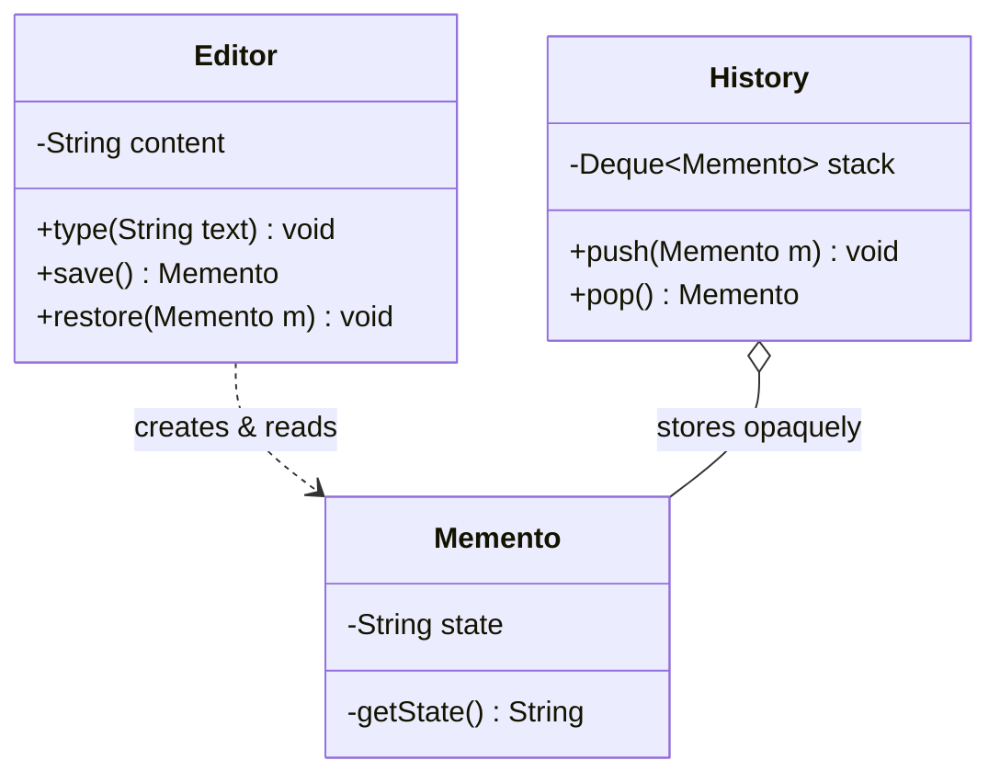

# Memento Design Pattern

Behavioral pattern: **captures and externalizes an object's internal state without violating encapsulation**, so that object can be restored to that state later. See [class-diagram.md](./class-diagram.md).

## The one-sentence mental model

> "Take a snapshot you can hand to someone else for safekeeping, without ever showing them what's inside it."

Think of a video game save file: the game (`Originator`) writes a save file (`Memento`), the OS/file system (`Caretaker`) just stores the bytes without understanding them, and only the game itself knows how to load that file back.

## What it does

- Lets an `Originator` capture its own internal state into a `Memento` object, without exposing that state's representation to anyone else.
- Hands the `Memento` to a `Caretaker`, which stores it opaquely (usually in a stack/list) and never reads or modifies its contents.
- Later, the `Originator` retrieves a previously stored `Memento` from the `Caretaker` and restores its own state from it.
- Enables **undo/rollback** without breaking encapsulation — the snapshot's fields stay private to the class that made them.

## When to use

- You need **undo/redo**, checkpoints, or rollback to a previous state.
- You want to snapshot an object's state but **don't want to expose its internals** (private fields) to the code that stores the snapshot.
- Direct field access to save/restore state would break encapsulation.

## When NOT to use

- The state to snapshot is large/expensive and you need many snapshots — memory cost can grow fast; consider incremental diffs or limiting history depth.
- A simpler approach (recomputing state, or storing a single previous value inline) is sufficient — Memento adds ceremony (an extra class + caretaker) that isn't justified for trivial state.

## How to use (small example)

```java
// Memento — opaque snapshot, only the Originator interprets it
class Memento {
    private final String state;
    Memento(String state) { this.state = state; }
    private String getState() { return state; } // package/private-ish: only Originator uses it
}

// Originator — creates and restores from mementos
class Editor {
    private String content = "";

    void type(String text) { content += text; }

    Memento save() { return new Memento(content); }

    void restore(Memento m) { content = m.getState(); }

    String getContent() { return content; }
}

// Caretaker — stores mementos opaquely, never reads them
class History {
    private final Deque<Memento> stack = new ArrayDeque<>();
    void push(Memento m) { stack.push(m); }
    Memento pop() { return stack.isEmpty() ? null : stack.pop(); }
}

// Client
Editor editor = new Editor();
History history = new History();

editor.type("Hello");
history.push(editor.save());
editor.type(" World");

System.out.println(editor.getContent());   // Hello World

Memento snapshot = history.pop();
if (snapshot != null) editor.restore(snapshot);

System.out.println(editor.getContent());   // Hello
```

Key idiom: `History` never touches `Memento.state` — it only calls `push`/`pop`. Only `Editor` (the `Originator`) ever calls `getState()`.

## Diagram



```
Client -> editor.type("Hello")
Client -> history.push(editor.save())
Client -> editor.type(" World")
Client -> editor.restore(history.pop())   // content reverts to "Hello"
```

## Roles (GoF)

| Role | Responsibility |
|---|---|
| **Originator** | Owns the real state; creates a `Memento` capturing it and can restore from one |
| **Memento** | Opaque snapshot of the originator's state; exposes nothing to outside classes |
| **Caretaker** | Stores/retrieves `Memento`s (usually as a stack for undo) without ever inspecting them |

## Memento vs. look-alikes

| Pattern | Intent |
|---|---|
| **Memento** | Snapshot an object's *state* for later restore, without exposing its internals |
| **Command** | Encapsulates a *request/action*; undo (if supported) re-runs an inverse operation rather than restoring a saved state blob |
| **Prototype** | Clones a whole object to produce a new independent instance; Memento captures state for the *same* object to restore into later, not to hand out as a new object |
| **State** | Changes an object's *behavior* based on internal state transitions; doesn't snapshot state for rollback |

## Real-world examples

- Undo/redo stacks in text editors and IDEs
- Database transaction rollback / savepoints
- Game save states / checkpoints
- `java.io.Serializable` combined with a version history store (snapshot an object graph to restore later)

## Scaling this pattern

The textbook shape is **one originator, one caretaker, one undo stack**. LLD interviews push past that with "now support undo for many independent objects at once" — here's what generally changes:

- **One history per originator, not a shared caretaker.** Each independent object (document, entity, session) needs its own stack of mementos, keyed by that object's id, instead of a single `Caretaker` mixing everyone's snapshots.
- **A registry replaces a single `List`/`Deque`.** A `CaretakerRegistry` (`Map<originatorId, Deque<Memento>>`) creates and looks up the right history by key, rather than the client wiring one caretaker per object by hand.
- **Bounded history becomes a real concern.** With many originators each accumulating snapshots, an unbounded stack per key adds up fast — real implementations cap depth per key or evict the oldest entries.
- **Thread-safety at the point of push/pop.** If multiple threads can save/restore the same originator concurrently, the stack operations (and the originator's own state mutation during restore) need synchronization to avoid a corrupted history or a lost update.
- **Past a single process, mementos get persisted.** Once undo history must survive a restart or be visible across nodes, `Memento`s are typically serialized to a DB row or log entry keyed by originator id + version, and the "caretaker" becomes a thin read/write layer over that store instead of an in-memory stack.
