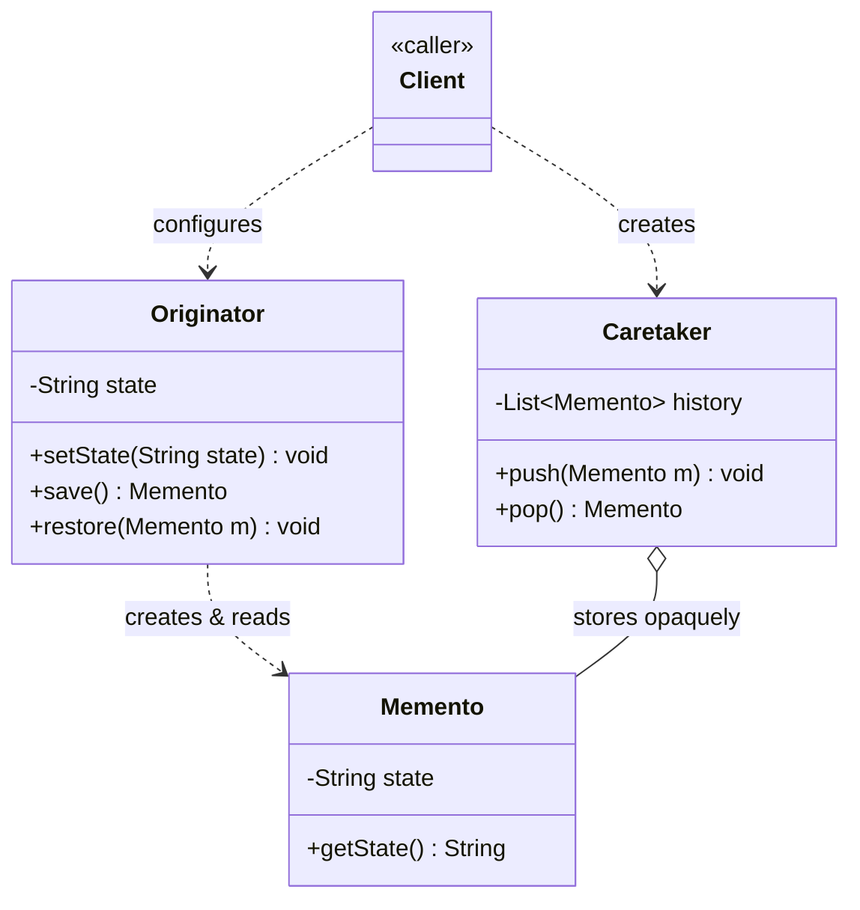
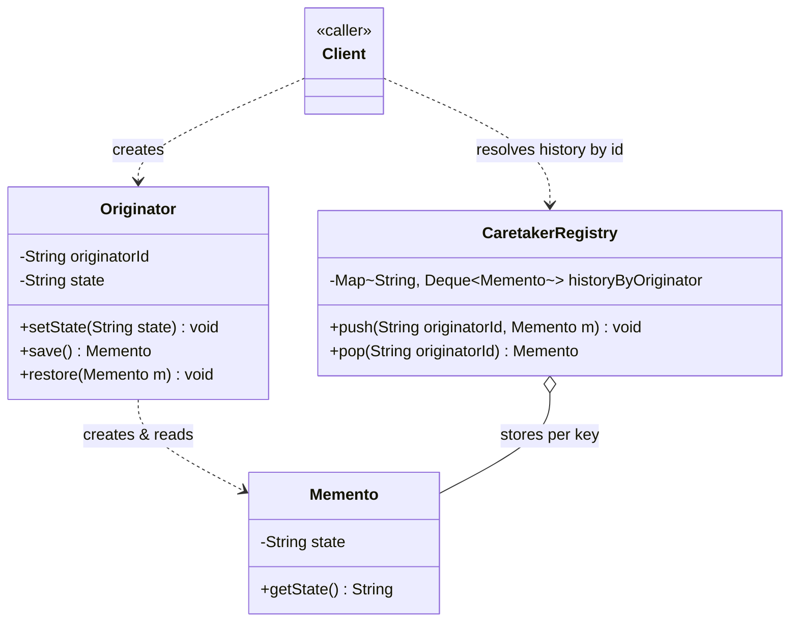

# Memento Design Pattern — Class Diagram

An `Originator` creates a `Memento` capturing its internal state, hands it to a `Caretaker` for safekeeping, and later asks for that same `Memento` back to restore itself — the `Caretaker` never looks inside it.

## Legend

| Arrow | Meaning |
|---|---|
| `..>` | dependency — creates / reads |
| `o--` | aggregation — caretaker holds mementos but never inspects or mutates their contents |

Only the `Originator` calls `getState()` on a `Memento`. The `Caretaker` holds a `List<Memento>` purely as a stack — it has no method that ever reaches into a memento's fields, which is what keeps the snapshot's internals opaque to everyone but the object that created it.

## Scaling: many instances

A single `Originator`/`Caretaker` pair undoing one object's history is the textbook shape. At LLD scale you usually need **many independent objects each with their own undo history** (many open documents, many game entities, many user sessions) — that changes where the history lives:

What changes:

- **One history stack per originator, not a single shared `Caretaker`.** Each independent object (document, entity, session) gets its own undo stack keyed by its id, instead of one `Caretaker` mixing every object's snapshots together.
- **`CaretakerRegistry`** replaces a single `List<Memento>` with a `Map<originatorId, Deque<Memento>>`, created and looked up by key rather than wired by hand per object.
- **Callers stop holding a fixed `Caretaker` reference** — they push/pop through the registry with an id, so an originator can be created, destroyed, and recreated without losing or leaking another originator's history.
- **Memory bounds become explicit**: an unbounded history per key across many originators grows without limit, so a real implementation caps stack depth (or evicts oldest snapshots) per key.
- **Past a single process**: once undo history must survive a restart or be shared across nodes, `Memento`s are typically serialized and persisted (a DB row or log entry keyed by originator id + version) instead of living only in an in-memory stack — the Caretaker's role becomes "read/write to storage" rather than "hold objects in memory."
