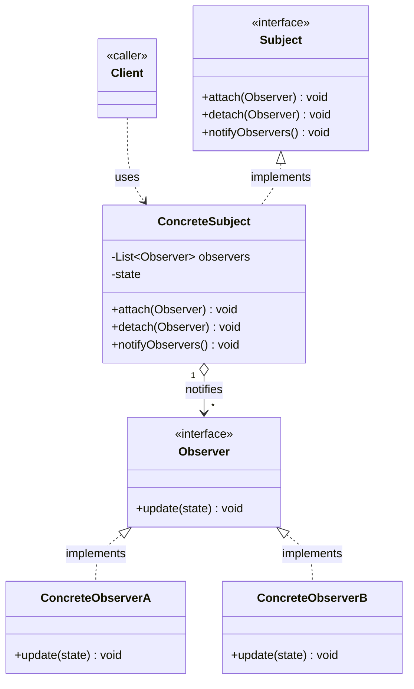

# Observer Pattern

Behavioral pattern: defines a **one-to-many dependency** between objects so that when one object (the subject) changes state, all its dependents (observers) are notified and updated automatically. See [class-diagram.md](./class-diagram.md).

## What it does

- The **subject** maintains a list of **observers** and exposes methods to subscribe (`add`/`attach`) and unsubscribe (`remove`/`detach`).
- When the subject's state changes, it iterates the list and calls `update()` on every registered observer — it doesn't know or care what each observer actually does with the notification.
- Observers implement a common interface so the subject can notify any of them **polymorphically**, without depending on concrete observer classes.
- Decouples the subject from its observers: new observer types can be added without touching the subject, and the subject can be reused with a completely different set of observers.

## When to use

- A change to one object must automatically **broadcast** to an open-ended, changeable set of other objects.
- You don't want the subject **tightly coupled** to the concrete classes that need to react to its changes.
- The classic case: event/notification systems — UI widgets reacting to model changes, pub/sub, listeners, stock/price alerts.

## When NOT to use

- There's only one fixed dependent — a direct method call is simpler than a subscription mechanism.
- Notifications need strict ordering/transactional guarantees or a request/response result back from each observer — Observer is fire-and-forget by design, not built for that.
- You need to worry about **thread-safety** or **memory leaks** (observers not unsubscribing keeping the subject alive) — those are real gotchas of naive Observer implementations.

## How to use (small example)

```java
// Observer
interface Observer {
    void update(int newState);
}

// ConcreteObserver
class ConsoleObserver implements Observer {
    public void update(int newState) {
        System.out.println("State changed to: " + newState);
    }
}

// Subject
interface Subject {
    void attach(Observer o);
    void detach(Observer o);
    void notifyObservers();
}

// ConcreteSubject
class StateHolder implements Subject {
    private final List<Observer> observers = new ArrayList<>();
    private int state;

    public void attach(Observer o) { observers.add(o); }
    public void detach(Observer o) { observers.remove(o); }
    public void notifyObservers() {
        for (Observer o : observers) o.update(state);
    }

    void setState(int state) {
        this.state = state;
        notifyObservers();
    }
}

// Client
StateHolder subject = new StateHolder();
subject.attach(new ConsoleObserver());
subject.setState(42);   // triggers notifyObservers() -> "State changed to: 42"
```

Key idiom: a variable of the **Subject** type is the thing being *watched* — name it accordingly (`...Subject` / `...Observable`), never `...Observer`; a variable of the **Observer** type is the *watcher*.

## Diagram



```
Client -> Subject.attach(observer)
Client -> ConcreteSubject.setState(x) -> notifyObservers() -> each Observer.update(x)
```

## Roles (GoF)

| Role | Responsibility |
|---|---|
| **Subject** | Interface declaring attach/detach/notify; knows its observers only via the Observer interface |
| **ConcreteSubject** | Holds the state that changes and the observer list; fires notifications |
| **Observer** | Interface declaring `update()`, implemented by anything that wants to react to subject changes |
| **ConcreteObserver** | Reacts to the notification — updates its own state or performs a side effect |

## Observer vs. look-alikes

| Pattern | Intent |
|---|---|
| **Observer** | One-to-many notification: a subject broadcasts state changes to registered observers |
| **Mediator** | Centralizes communication **between peers** so they don't reference each other directly, not a one-to-many broadcast from one source |
| **Pub/Sub** | Same idea as Observer but decoupled further via a message broker/event bus — publishers and subscribers don't hold direct references to each other |
| **Chain of Responsibility** | Passes a request along a chain until one handler deals with it, instead of notifying everyone |

## Real-world examples

- Java's built-in `java.util.Observer`/`Observable` (deprecated since Java 9, but the canonical textbook example)
- `java.beans.PropertyChangeListener` / `PropertyChangeSupport`
- GUI event listeners: Swing's `ActionListener`, Android's `View.OnClickListener`
- Reactive streams / RxJava `Observable` and `Subscriber`
- Message brokers (Kafka, RabbitMQ) implementing the pattern at a distributed-systems scale
