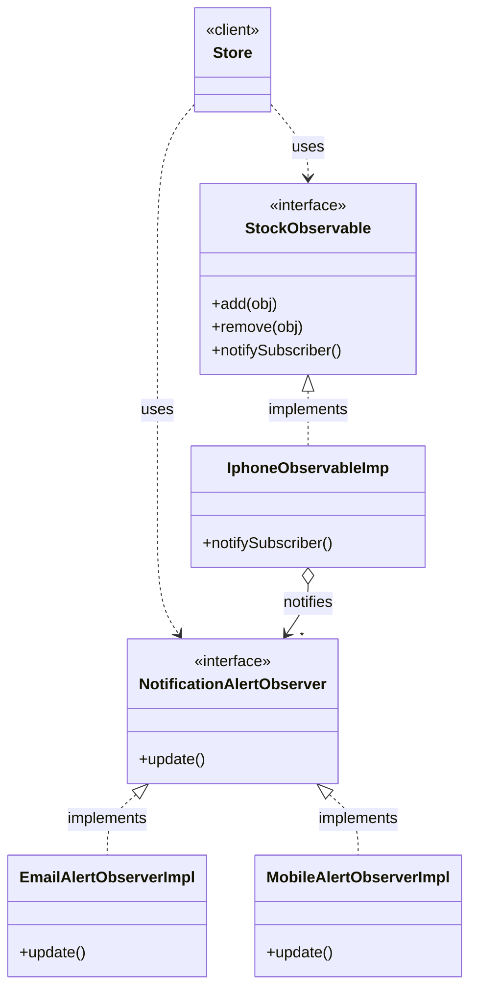

# Observer Pattern — Class Diagram

Best-practice layout is a combination, not one or the other: each interface's implementers render **top-to-bottom** below it (standard for realization/inheritance), while the two independent hierarchies — the Subject side (`StockObservable`) and the Observer side (`NotificationAlertObserver`) — sit **side-by-side** since neither depends on the other, only `IphoneObservableImp` aggregates the observers.

## Legend

| Arrow | Meaning |
|---|---|
| `..>` | dependency — uses |
| `<\|..` | realization — class implements interface |
| `o-->` | aggregation — subject holds a list of observers |

## Role mapping

| GoF role | This code |
|---|---|
| Subject | `StockObservable` → `IphoneObservableImp` |
| Observer | `NotificationAlertObserver` → `EmailAlertObserverImpl`, `MobileAlertObserverImpl` |

Rule of thumb: anything typed `StockObservable` is the thing being *watched* — name it `...Observable`, never `...Observer`.
