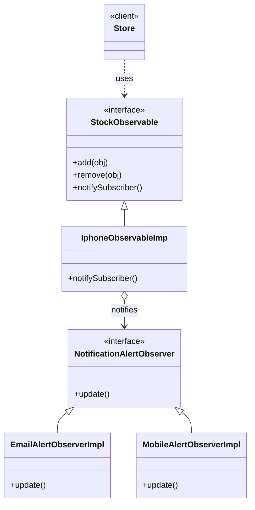

# Observer Pattern — Class Diagram

`StockObservable` (Subject) sits on the left with its child `IphoneObservableImp` below it. `NotificationAlertObserver` (Observer) sits on the right with its two children below it. The subject holds a list of observers and calls `update()` on each one.

## Legend

| Arrow | Meaning |
|---|---|
| `..>` | dependency — uses |
| `<\|--` | child implements/extends parent |
| `o-->` | subject holds a list of observers |

## Role mapping

| GoF role | This code |
|---|---|
| Subject | `StockObservable` → `IphoneObservableImp` |
| Observer | `NotificationAlertObserver` → `EmailAlertObserverImpl`, `MobileAlertObserverImpl` |

Rule of thumb: anything typed `StockObservable` is the thing being *watched* — name it `...Observable`, never `...Observer`.
