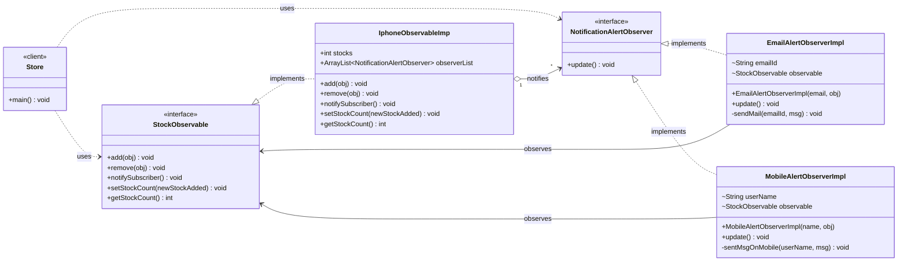

# Observer Pattern — Class Diagram

`IphoneObservableImp` (subject) keeps a list of `NotificationAlertObserver`s and calls `update()` on each when stock comes back.

## Legend

| Arrow | Meaning |
|---|---|
| `..>` | dependency — client uses the interfaces |
| `<\|..` | realization — class implements interface |
| `o-->` | aggregation — subject holds its list of observers |
| `-->` | association — observer keeps a reference to the subject |
