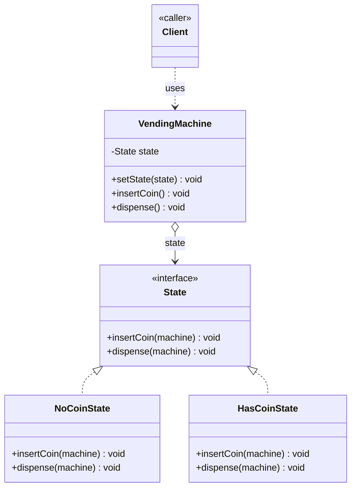

# State Design Pattern

Behavioral pattern: lets an object **change its behaviour when its internal state changes**, so it looks like the object changed class. See [class-diagram.md](./class-diagram.md).

## What it does

- Extracts each state's behaviour into its own `ConcreteState` class implementing a common `State` interface.
- `Context` holds a reference to the *current* `State` object and forwards requests to it instead of branching on a status flag/enum.
- Each `ConcreteState` decides what the *next* state should be — transition logic lives with the state, not in the `Context`.
- Adding a new state means adding a new class, not editing a big `switch`/`if-else` chain in `Context`.

## When to use

- An object's behaviour depends on a **finite set of states**, and it must change behaviour at runtime as its state changes.
- You have large conditional blocks (`if/else` or `switch` on a status field) scattered across methods, all checking the same state variable.
- Transitions between states follow clear rules and you want each state to own its own transition logic.

## When NOT to use

- Only two or three static behaviours exist and they never grow — a simple `if/else` or enum + switch is clearer and cheaper.
- States don't actually have distinct *behaviour*, only distinct *data* — that's just a data class, not this pattern.

## How to use (small example)

```java
// State — behaviour contract for one state
interface State {
    void insertCoin(VendingMachine machine);
    void dispense(VendingMachine machine);
}

// ConcreteState A
class NoCoinState implements State {
    public void insertCoin(VendingMachine machine) {
        System.out.println("Coin accepted");
        machine.setState(new HasCoinState());
    }
    public void dispense(VendingMachine machine) {
        System.out.println("Insert coin first");
    }
}

// ConcreteState B
class HasCoinState implements State {
    public void insertCoin(VendingMachine machine) {
        System.out.println("Already have a coin");
    }
    public void dispense(VendingMachine machine) {
        System.out.println("Dispensing item");
        machine.setState(new NoCoinState());
    }
}

// Context
class VendingMachine {
    private State state = new NoCoinState();

    void setState(State state) { this.state = state; }
    void insertCoin() { state.insertCoin(this); }
    void dispense()   { state.dispense(this); }
}

// Client
VendingMachine machine = new VendingMachine();
machine.dispense();     // "Insert coin first"
machine.insertCoin();   // "Coin accepted"
machine.dispense();     // "Dispensing item"
```

Key idiom: `VendingMachine` never checks "if state == NO_COIN" — it just calls `state.insertCoin(this)` / `state.dispense(this)` and each `State` implementation decides what happens and what the next state is.

## Diagram



```
Client -> machine.insertCoin() -> state.insertCoin(machine) -> machine.setState(HasCoinState)
Client -> machine.dispense()   -> state.dispense(machine)   -> machine.setState(NoCoinState)
```

## Roles (GoF)

| Role | Responsibility |
|---|---|
| **State** | Interface declaring the behaviours that vary per state |
| **ConcreteState** | Implements behaviour for one specific state, and decides the next state |
| **Context** | Holds the current `State` reference; delegates requests to it; exposes `setState()` |
| **Client** | Interacts only with `Context`, unaware of which `ConcreteState` is active |

## State vs. look-alikes

| Pattern | Intent |
|---|---|
| **State** | Object's behaviour changes with its internal state; states know how to transition to each other |
| **Strategy** | Client explicitly picks an interchangeable algorithm; strategies typically don't know about each other or transition on their own |
| **Command** | Encapsulates a *request* as an object (with undo/queueing); not about representing "what state am I in" |
| **Chain of Responsibility** | Passes a request along a chain until someone handles it; not about representing mutually exclusive states of one object |

## Real-world examples

- `java.util.concurrent.Future` / `Thread` — internal lifecycle states (NEW, RUNNABLE, TERMINATED, ...) drive different allowed operations
- TCP connection state machines (LISTEN, SYN_SENT, ESTABLISHED, CLOSED, ...)
- UI components — a button's `Enabled`/`Disabled`/`Pressed` states change how it responds to clicks
- Order/workflow systems — `Order` behaving differently in `Placed`, `Shipped`, `Delivered`, `Cancelled` states

## Scaling this pattern

- **Many concurrent contexts**: instead of one hardcoded `Context` instance, use a registry/factory keyed by context id (`orderId`, `connectionId`, ...) that looks up or creates the right `Context`.
- **Stateless states as singletons**: `ConcreteState` classes that hold no per-context data (like `NoCoinState` above) can be shared singletons across every `Context`, rather than allocated fresh on every transition — cuts allocation churn at scale.
- **Thread-safety**: `Context.setState()` mutates shared state — under concurrent access, guard the state reference (e.g. `AtomicReference<State>` or a lock) so two threads can't race to apply conflicting transitions.
- **Distributed scale**: once a single process/JVM isn't enough (e.g. state must survive restarts or be shared across services), the in-memory `state` field becomes a persisted state column/document plus an event log, and transitions are driven by messages from a broker/event bus instead of direct method calls — same decoupling idea, now durable and cross-service.
