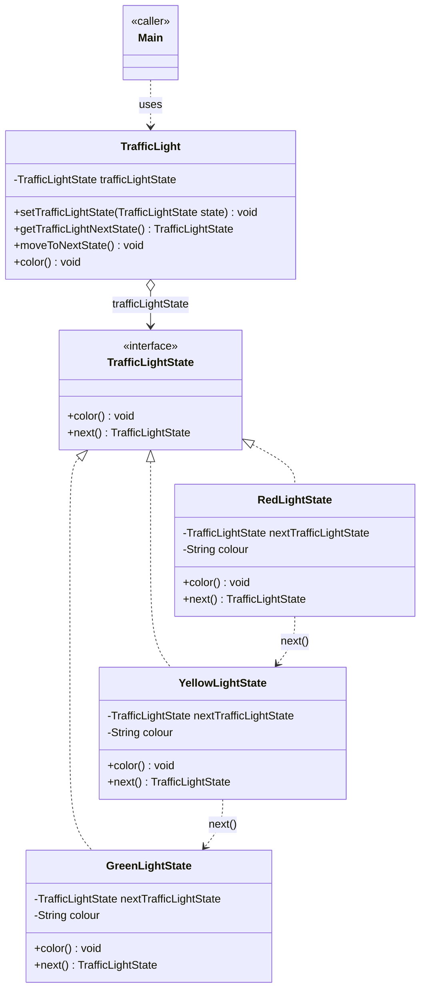
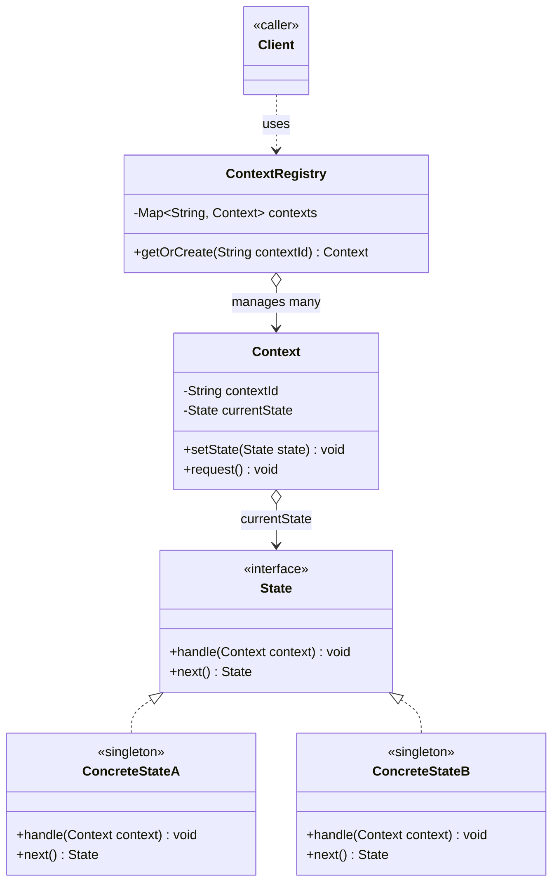

# State Design Pattern — Class Diagram

`TrafficLight` (the `Context`) holds a reference to the current `TrafficLightState` and delegates to it. Each concrete state (`GreenLightState`, `YellowLightState`, `RedLightState`) implements the behaviour for one colour and decides what the next state should be — `TrafficLight`'s code never branches on "if colour == X".

## Legend

| Arrow | Meaning |
|---|---|
| `<\|..` | realization — implements an interface (parent listed first) |
| `o-->` | aggregation — `TrafficLight` holds a `TrafficLightState` reference, doesn't own its lifecycle |
| `..>` | dependency — uses / transitions to |

Interfaces/base types are named first in each relation (`TrafficLightState <|.. GreenLightState`) so Mermaid ranks them above their implementers in the `direction TB` layout, matching standard UML.

## Scaling: many instances

A single `Context` object with one mutable `currentState` field is fine for a textbook example, but breaks down once many contexts need independent state at once (e.g. one traffic light per intersection, one order per customer). The fix is a registry/factory keyed by context id, and states that are stateless singletons shared across all contexts rather than newly allocated per transition:

Each `ConcreteState` becomes a stateless singleton (safe to share since it holds no per-context data), and `ContextRegistry` looks up or creates the right `Context` by id instead of the program holding one hardcoded instance.
