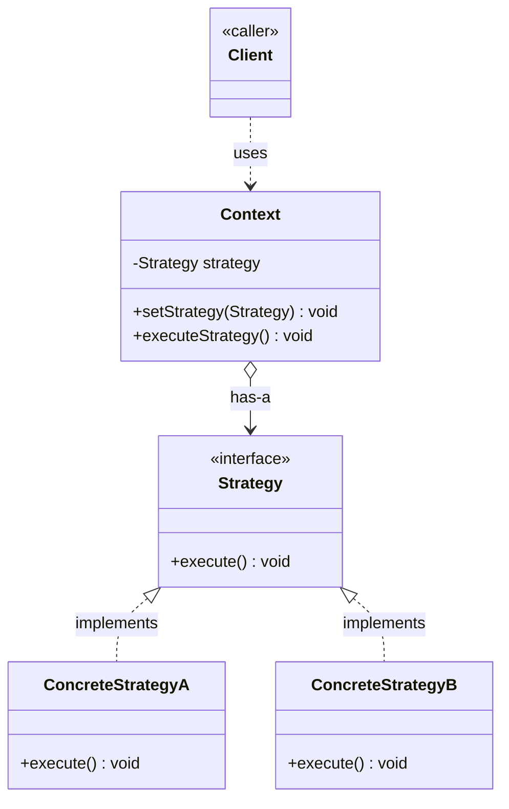

# Strategy Design Pattern

Behavioral pattern: defines a **family of interchangeable algorithms**, encapsulates each one behind a common interface, and lets the client swap the algorithm a context object uses at runtime, independent of the clients that use it. See [class-diagram.md](./class-diagram.md).

## What it does

- Pulls a varying **behavior/algorithm** out of a class into its own hierarchy of strategy objects, all implementing one interface.
- The **context** class holds a reference to a strategy and delegates the behavior to it instead of implementing it directly.
- Different concrete strategies can be plugged into the same context — either at construction time or later via a setter — without changing the context's code.
- Replaces long `if/else` or `switch` blocks that pick behavior by type, and replaces duplicated subclass overrides (parallel class explosion) with composition.

## When to use

- Multiple related classes differ **only in behavior**, and that behavior would otherwise be duplicated across subclasses or a big conditional.
- You need to switch an algorithm/behavior **at runtime** based on configuration, user choice, or context.
- You want to isolate algorithm-specific data/logic from the client code that uses it, so new algorithms can be added without touching the context or client.
- You're tempted to add a `type` flag and branch on it (`if (type == SPORTS) ... else if (type == NORMAL) ...`) — that's the signal to extract a strategy instead.

## When NOT to use

- There's only one algorithm, or algorithms never change — a strategy hierarchy is unnecessary indirection.
- The number of strategies is small and fixed, and a simple conditional is clearer than an interface + several classes.
- The strategies need to share a lot of state/logic with the context — Template Method (inheritance) may fit better than composition here.

## How to use (small example)

```java
// Strategy
interface DriveStrategy {
    void drive();
}

// ConcreteStrategy
class NormalDriveStrategy implements DriveStrategy {
    public void drive() { System.out.println("Normal drive"); }
}

class SportsDriveStrategy implements DriveStrategy {
    public void drive() { System.out.println("Sports drive"); }
}

// Context
class Vehicle {
    private DriveStrategy driveStrategy;

    Vehicle(DriveStrategy driveStrategy) { this.driveStrategy = driveStrategy; }

    void setDriveStrategy(DriveStrategy driveStrategy) { this.driveStrategy = driveStrategy; }

    void drive() { driveStrategy.drive(); }
}

// Client
Vehicle vehicle = new Vehicle(new NormalDriveStrategy());
vehicle.drive();                                  // Normal drive
vehicle.setDriveStrategy(new SportsDriveStrategy());
vehicle.drive();                                  // Sports drive — swapped at runtime
```

Key idiom: the context is coded against the `DriveStrategy` **interface**, never a concrete strategy — the actual strategy is injected (constructor or setter), so context and algorithm vary independently.

## Diagram



```
Client -> Context.setStrategy(concreteStrategy)
Client -> Context.executeStrategy() -> Strategy.execute() -> ConcreteStrategy logic
```

## Roles (GoF)

| Role | Responsibility |
|---|---|
| **Strategy** | Interface common to all supported algorithms |
| **ConcreteStrategy** | One specific implementation of the algorithm |
| **Context** | Holds a reference to a Strategy and delegates work to it |
| **Client** | Configures the Context with a concrete strategy |

## Strategy vs. look-alikes

| Pattern | Intent |
|---|---|
| **Strategy** | Swap interchangeable **algorithms**, chosen/composed at runtime, via composition |
| **State** | Swap behavior based on an object's **internal state**, transitions often driven by the state objects themselves |
| **Template Method** | Fixes the algorithm's skeleton in a base class, lets subclasses override individual **steps** via inheritance |
| **Bridge** | Decouples an **abstraction** from its **implementation** so both can vary independently (structural, not behavioral) |

## Real-world examples

- `java.util.Comparator` passed to `Collections.sort(list, comparator)` / `List.sort(...)`
- `java.util.concurrent.ThreadPoolExecutor`'s `RejectedExecutionHandler`
- Payment processing (`CreditCardStrategy`, `PayPalStrategy`, `UpiStrategy`) behind one `PaymentStrategy` interface
- Compression/serialization libraries choosing an algorithm (`ZipStrategy`, `GzipStrategy`) behind a common interface
