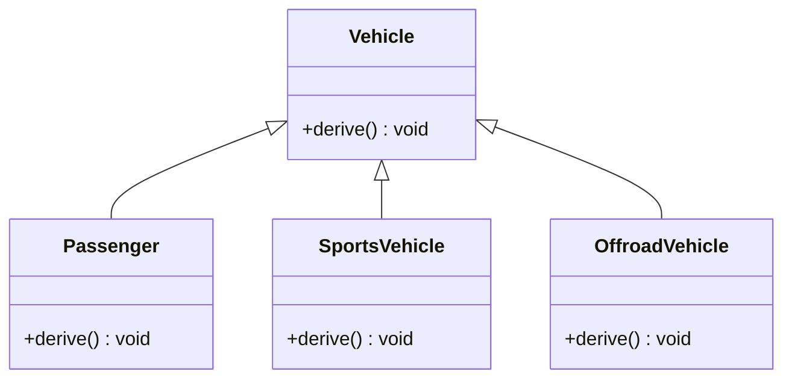
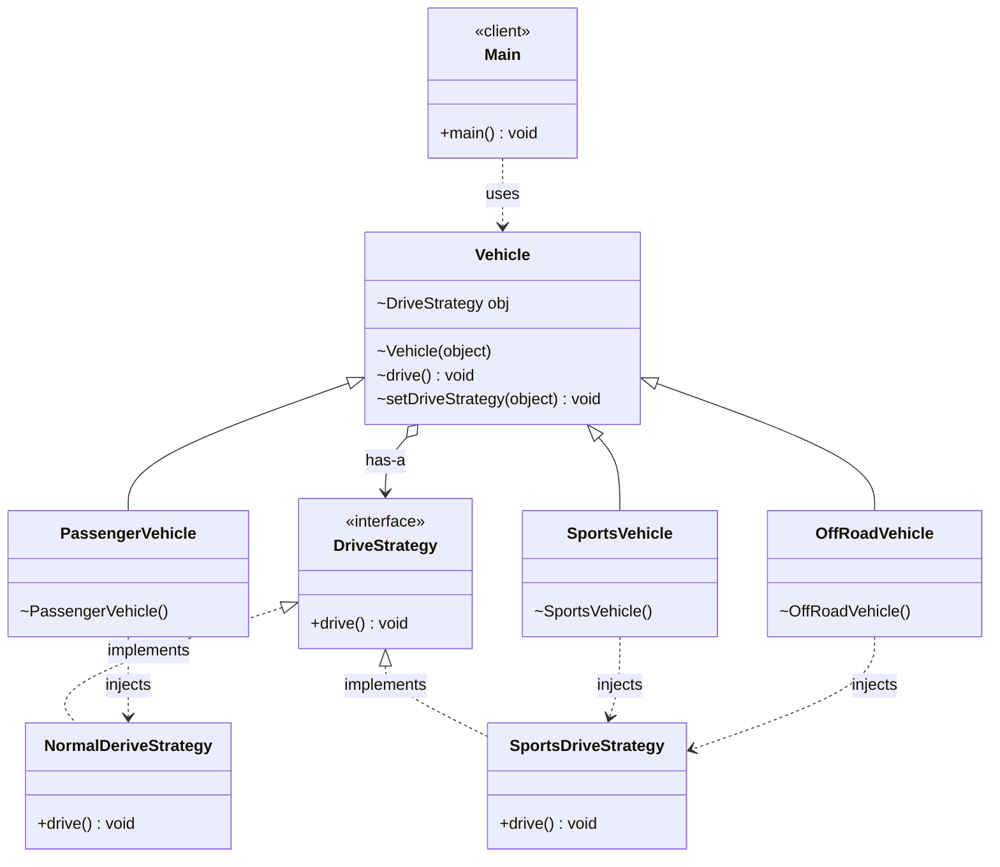

# Strategy Design Pattern — Class Diagram

## Without Strategy Pattern

Each subclass overrides `derive()`, so the same behaviour is duplicated (`SportsVehicle` and `OffroadVehicle` hold identical code).

## With Strategy Pattern

Driving behaviour is pulled out into `DriveStrategy`. `Vehicle` holds a strategy and delegates `drive()` to it; each subclass only picks a strategy in its constructor, so `SportsVehicle` and `OffRoadVehicle` share `SportsDriveStrategy` instead of copying code.

## Legend

| Arrow | Meaning |
|---|---|
| `..>` | dependency — uses / passes to `super(...)` |
| `<\|--` | inheritance — extends class |
| `<\|..` | realization — class implements interface |
| `o-->` | aggregation — vehicle holds its drive strategy |
