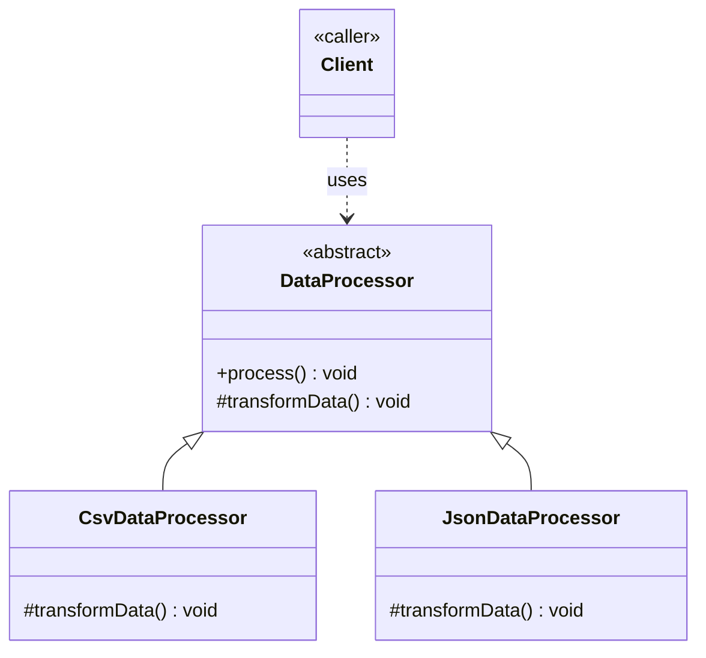

# Template Method Design Pattern

Behavioral pattern: defines the **skeleton of an algorithm** in a base class, deferring some steps to subclasses **without letting them change the overall structure**. See [class-diagram.md](./class-diagram.md).

## What it does

- `AbstractClass` implements a `templateMethod()` (usually `final`) that calls a fixed sequence of steps.
- Some steps are implemented in the base class (shared/default behaviour); others are `abstract` (or have a default that subclasses may override) — these are the "hook"/"primitive" operations.
- `ConcreteClass` subclasses only fill in the varying steps; the algorithm's shape and order stay fixed and un-overridable.
- Inverts control compared to a subclass calling the base class: here the *base class calls the subclass* ("Hollywood principle" — "don't call us, we'll call you").

## When to use

- Several classes implement the same algorithm/workflow with the same overall steps, but a few steps differ per class — and that duplication is currently copy-pasted across them.
- You want to enforce a fixed sequence of steps while still allowing customization of specific parts.
- You want to give subclasses optional "hooks" to plug in extra behaviour at defined points, without letting them change the algorithm's structure.

## When NOT to use

- The steps genuinely need to vary independently at runtime (swap the whole algorithm, not just one step) — that's Strategy, not Template Method.
- There's only one implementation and no foreseeable second one — the abstraction adds indirection for no benefit yet.
- Deep template method hierarchies (subclasses of subclasses tweaking different steps) get hard to follow — prefer composition (Strategy) once step count/variation grows.

## How to use (small example)

```java
// AbstractClass — defines the skeleton
abstract class DataProcessor {
    // template method — fixed algorithm, not overridable
    public final void process() {
        readData();
        transformData();
        writeData();
    }

    private void readData() {
        System.out.println("Reading raw data...");
    }

    protected abstract void transformData();

    private void writeData() {
        System.out.println("Writing processed data...");
    }
}

// ConcreteClassA
class CsvDataProcessor extends DataProcessor {
    @Override
    protected void transformData() {
        System.out.println("Parsing CSV rows...");
    }
}

// ConcreteClassB
class JsonDataProcessor extends DataProcessor {
    @Override
    protected void transformData() {
        System.out.println("Parsing JSON fields...");
    }
}

// Client
DataProcessor processor = new CsvDataProcessor();
processor.process();
```

Key idiom: `process()` is `final` — subclasses can change *what happens during* `transformData()`, never the order `readData() -> transformData() -> writeData()`.

## Diagram



```
Client -> processor.process()
            -> readData()
            -> transformData()   [dispatches to CsvDataProcessor/JsonDataProcessor]
            -> writeData()
```

## Roles (GoF)

| Role | Responsibility |
|---|---|
| **AbstractClass** | Defines the template method (fixed algorithm skeleton) and declares the primitive/hook operations |
| **ConcreteClass** | Implements the primitive operations to provide the variant-specific behaviour |
| **Client** | Invokes the template method on a `ConcreteClass` instance, unaware of the internal steps |

## Template Method vs. look-alikes

| Pattern | Intent |
|---|---|
| **Template Method** | Fixed algorithm structure in a base class; subclasses fill in specific steps (inheritance-based) |
| **Strategy** | Entire algorithm is swappable at runtime via composition; no fixed base-class skeleton |
| **Factory Method** | A special case of Template Method focused purely on delegating *object creation* to subclasses |
| **Decorator** | Wraps an object to add behaviour dynamically, without a shared fixed algorithm skeleton |

## Real-world examples

- `java.io.InputStream`/`OutputStream` — many methods build on a subclass-provided `read()`/`write()` primitive
- `AbstractList`/`AbstractMap` in the JDK Collections framework — provide default implementations built on a few abstract primitives (`get(int)`, `size()`, ...)
- JUnit/TestNG lifecycle — fixed `setUp() -> runTest() -> tearDown()` sequence, with test classes only filling in `runTest()`
- Spring's `JdbcTemplate` — fixed connection/statement/cleanup skeleton, caller supplies only the query-specific callback

## Scaling this pattern

- **Many concurrent variants**: instead of the client hardcoding `new ConcreteClassA()`, use a `ConcreteClassFactory`/registry keyed by variant id, resolved from configuration or a plugin/DI mechanism.
- **Composable steps**: if the number of independently-varying steps grows, a rigid inheritance hierarchy (one subclass per combination) explodes — consider decomposing further into injected `Strategy` objects for each step instead of subclassing.
- **Thread-safety**: if `AbstractClass` holds mutable instance state shared across calls to `templateMethod()`, guard it under concurrent access, same as any shared mutable object — stateless template methods avoid this entirely.
- **Distributed scale**: once the algorithm's steps run across process/service boundaries (e.g. a pipeline stage per service), the in-process template method call sequence becomes an orchestrated workflow (e.g. a saga/pipeline orchestrator invoking each step as a remote call), while each step's substitutability still mirrors the original Template Method idea.
