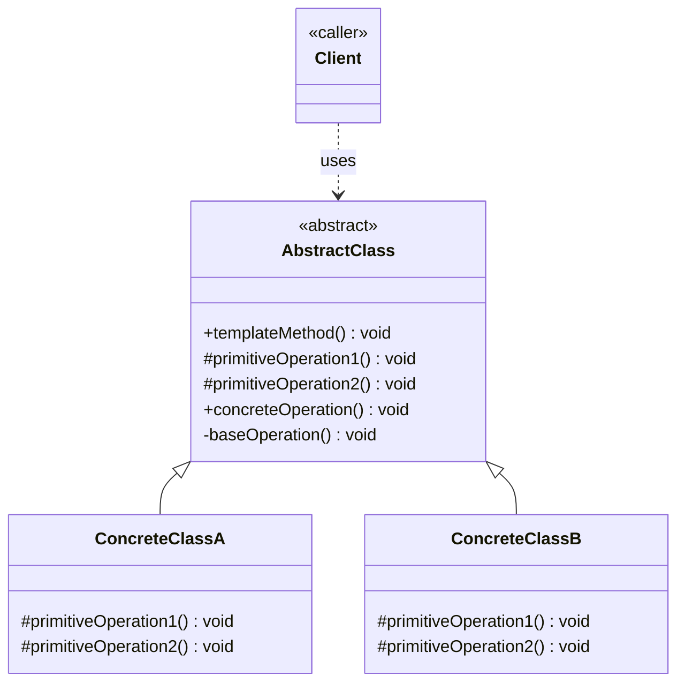
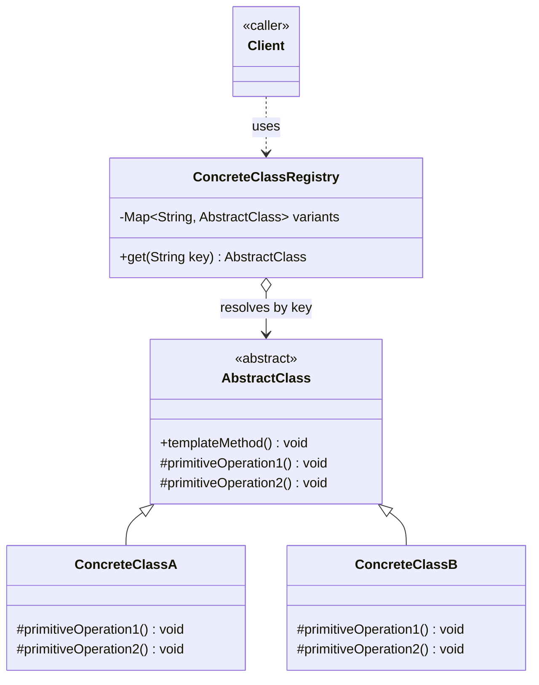

# Template Method Design Pattern — Class Diagram

`AbstractClass` defines the skeleton of an algorithm in a `final` template method, calling a fixed sequence of steps — some implemented once (common/default steps), some left `abstract` for subclasses to fill in. `ConcreteClass` subclasses only override the varying steps; they never touch the sequence itself.

## Legend

| Arrow | Meaning |
|---|---|
| `<|--` | inheritance — extends an abstract base class (parent listed first) |
| `..>` | dependency — uses / calls |

Base classes are named first in each relation (`AbstractClass <|-- ConcreteClassA`) so Mermaid ranks them above their subclasses in the `direction TB` layout, matching standard UML.

## Scaling: many instances

A single hardcoded `AbstractClass` hierarchy is fine when the set of variants is small and known at compile time. At scale — many variants selected dynamically, or built from configuration rather than a fixed class per variant — a `ConcreteClassFactory`/registry resolves the right `ConcreteClass` by key instead of the client instantiating one directly:

Each `ConcreteClass` is registered under a key (e.g. by config, plugin discovery, or DI container) instead of the client hardcoding `new ConcreteClassA()`; the client asks the registry for "the variant for this key" and calls `templateMethod()` on whatever comes back.
