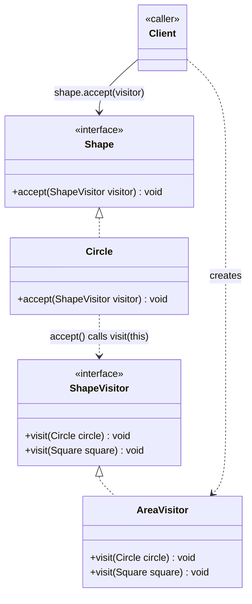

# Visitor Design Pattern

Behavioral pattern: **separates an algorithm from the object structure it operates on**, letting you add new operations over a fixed set of element types without modifying those types. See [class-diagram.md](./class-diagram.md).

## The one-sentence mental model

> "Instead of adding a new method to every element class for each new operation, hand each element a visitor and let it call back the right overload for its own type."

Think of it like a tax auditor visiting different kinds of businesses: the auditor (`Visitor`) knows different rules for a restaurant vs. a retail shop, but each business (`Element`) just "accepts" the auditor and lets them do their job — the business doesn't need to know what the audit involves.

## What it does

- Defines a `Visitor` interface with one `visit()` overload per concrete `Element` type.
- Each `Element` implements `accept(Visitor visitor)` by calling `visitor.visit(this)` — this is **double dispatch**: the call resolves first on the element's real type (via `accept`), then on the visitor's overload matching that type.
- New operations are added by writing a new `ConcreteVisitor`, **without touching any `Element` class**.
- Adding a new `Element` type, conversely, requires updating every existing `Visitor` — the trade-off runs the opposite way from normal OOP extension.

## When to use

- You need to perform **many distinct, unrelated operations** across a stable set of classes (e.g., pretty-printing, validation, export, billing) and don't want to bloat each class with all of them.
- The **object structure (element types) is stable**, but the operations performed on it change or grow often.
- You want to gather related behavior that would otherwise be **scattered across many classes** into one cohesive visitor class.

## When NOT to use

- The set of element types changes frequently — every new type forces edits to every visitor, which is the opposite of open/closed.
- There's only one or two simple operations — a plain method on each class (or a `switch`/`instanceof` check) is simpler than the double-dispatch machinery.
- Elements need to expose internal state that's awkward or unsafe to leak out through a visitor interface.

## How to use (small example)

```java
// Element — accepts a visitor
interface Shape {
    void accept(ShapeVisitor visitor);
}

class Circle implements Shape {
    double radius;
    Circle(double radius) { this.radius = radius; }
    @Override public void accept(ShapeVisitor visitor) { visitor.visit(this); }
}

class Square implements Shape {
    double side;
    Square(double side) { this.side = side; }
    @Override public void accept(ShapeVisitor visitor) { visitor.visit(this); }
}

// Visitor — one overload per concrete element
interface ShapeVisitor {
    void visit(Circle circle);
    void visit(Square square);
}

// ConcreteVisitor — a new operation, no Shape class touched
class AreaVisitor implements ShapeVisitor {
    @Override public void visit(Circle circle) {
        System.out.println("Area: " + Math.PI * circle.radius * circle.radius);
    }
    @Override public void visit(Square square) {
        System.out.println("Area: " + square.side * square.side);
    }
}

// Client
List<Shape> shapes = List.of(new Circle(2), new Square(3));
ShapeVisitor areaVisitor = new AreaVisitor();
for (Shape shape : shapes) {
    shape.accept(areaVisitor);
}
```

Key idiom: `Circle.accept()` calls `visitor.visit(this)` where `this` is statically typed as `Circle` — that's what selects `visit(Circle)` over `visit(Square)` at the second dispatch. Adding a `TrianglePerimeterVisitor` later needs zero changes to `Circle` or `Square`.

## Diagram



```
Client -> shape.accept(areaVisitor)
Circle.accept(areaVisitor) -> areaVisitor.visit(this)   // resolves to visit(Circle)
AreaVisitor.visit(Circle) -> prints area
```

## Roles (GoF)

| Role | Responsibility |
|---|---|
| **Visitor** | Interface declaring one `visit()` overload per concrete element type |
| **ConcreteVisitor** | Implements each `visit()` overload — one operation across the whole element structure |
| **Element** | Interface declaring `accept(Visitor visitor)` |
| **ConcreteElement** | Implements `accept()` by calling `visitor.visit(this)`, triggering double dispatch |
| **Client** | Builds the element structure and the visitor, then drives `element.accept(visitor)` over each element |

## Visitor vs. look-alikes

| Pattern | Intent |
|---|---|
| **Visitor** | Add new operations over a fixed set of types via double dispatch, without modifying those types |
| **Strategy** | Swap one interchangeable algorithm at a time; no notion of dispatching across a whole heterogeneous structure |
| **Iterator** | Traverse a collection's elements one by one; doesn't add new operations to the elements it traverses |
| **Command** | Wrap a single request as an object bound to one receiver; not about performing per-type operations across many classes |
| **Composite** (paired with Visitor) | Composite defines the tree structure being traversed; Visitor is often walked *over* a Composite to apply an operation uniformly across nodes |

## Real-world examples

- Java compilers/AST tooling (`javax.lang.model.util.ElementVisitor`, ANTLR generated visitors) — walk a syntax tree applying type-checking, code generation, or linting without editing node classes
- `java.nio.file.FileVisitor` — one visitor interface with callbacks per file-tree event (`visitFile`, `preVisitDirectory`, ...) used by `Files.walkFileTree`
- XML/JSON object-model processors (DOM visitors, Jackson's `JsonNode` traversal) — apply serialization/validation logic without adding methods to every node type
- IDE/static-analysis tools — one visitor per lint rule or refactoring, walked over a stable AST node hierarchy

## Scaling this pattern

- **Dynamic visitor selection**: a fixed pair of `ConcreteVisitor`s doesn't scale when the operation to run must be chosen per request (feature flag, tenant, plugin) — introduce a `VisitorRegistry`/factory keyed by an operation id, so the client resolves *which* visitor to use at runtime while elements still only depend on the `Visitor` interface.
- **Per-call resolution instead of construction-time binding**: in the textbook shape, `accept()` is called with one fixed visitor instance. At scale, a visitor might need to be built per call (carrying request-scoped context) rather than reused as a shared singleton — pass a builder/factory instead of a bare instance where visitors carry mutable state.
- **Thread-safety**: if a `ConcreteVisitor` accumulates results (e.g., a running total across many elements) and is shared across concurrent traversals, that accumulator must be synchronized, made immutable per call, or replaced with a thread-local/fresh instance per traversal.
- **Beyond a single process**: when the element structure is distributed (sharded data, elements living in different services), the in-memory `accept()`/`visit()` call pair becomes a serialized operation dispatched over RPC or a message queue — each remote element still reports "here's my type, here's the operation to run on me," just across a network boundary instead of a direct method call.
