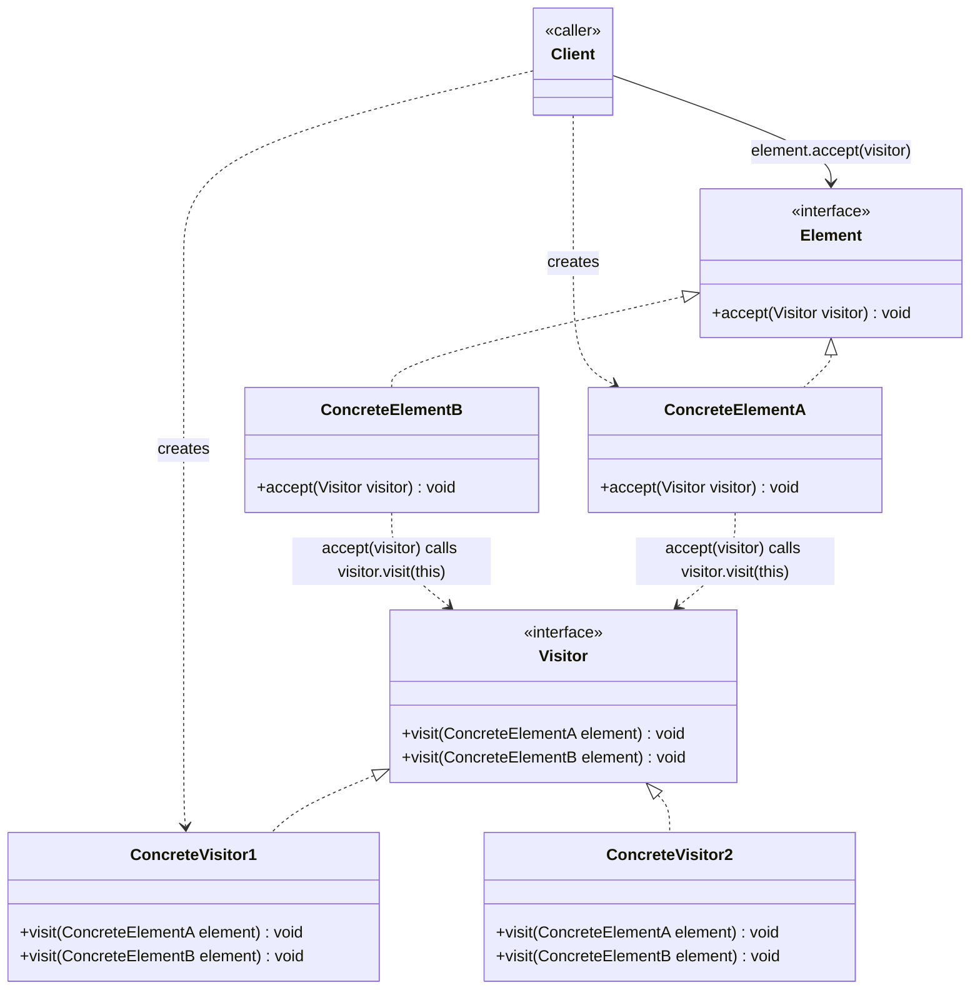
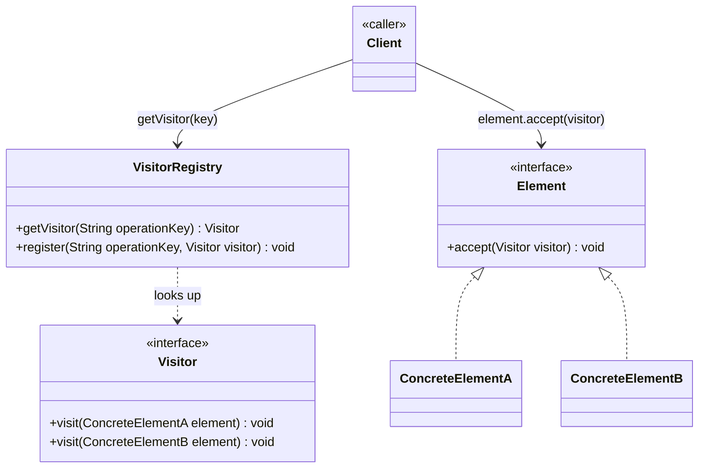

# Visitor Design Pattern — Class Diagram

An `Element` hierarchy accepts a `Visitor`, and each `ConcreteElement` calls back the overload matching its own type — double dispatch lets new operations be added without touching the elements themselves.

## Legend

| Arrow | Meaning |
|---|---|
| `<\|..` | realization — written `Interface <\|.. Implementation`; the interface goes first (parent role) so it renders above the classes that implement it |
| `..>` | dependency — uses / instantiates |
| `-->` | association — holds a reference to and calls |

**Layout convention**: relationship arrows are always written *parent/interface first* (`Interface <|.. Implementation`), never child-first. This is what makes Mermaid rank `Element`/`Visitor` above their implementers in a `TB` diagram instead of scattering them left/right/below inconsistently.

**Why double dispatch matters**: `Client` only knows `Element` and calls `element.accept(visitor)`. A single-dispatch call like `visitor.visit(element)` would resolve to `visit(Element)` at compile time, losing the concrete type. `accept()` re-dispatches from inside the concrete element (`visitor.visit(this)`), where `this` has its real compile-time type — so the *second* dispatch picks the right `visit(ConcreteElementX)` overload. That's the whole trick that lets a new operation (`ConcreteVisitor`) be added without editing any `Element`.

## Scaling: many instances

A hard-coded pair of visitors covers a fixed, small set of element types. It breaks down when operations must be registered/looked up dynamically (plugins, per-tenant behavior) rather than compiled in as fixed `visit()` overloads:

`VisitorRegistry` looks up which `Visitor` implementation applies for a given operation key (feature flag, tenant config, plugin id) at runtime — elements still only depend on the `Visitor` interface, never on which concrete visitor they got back.
