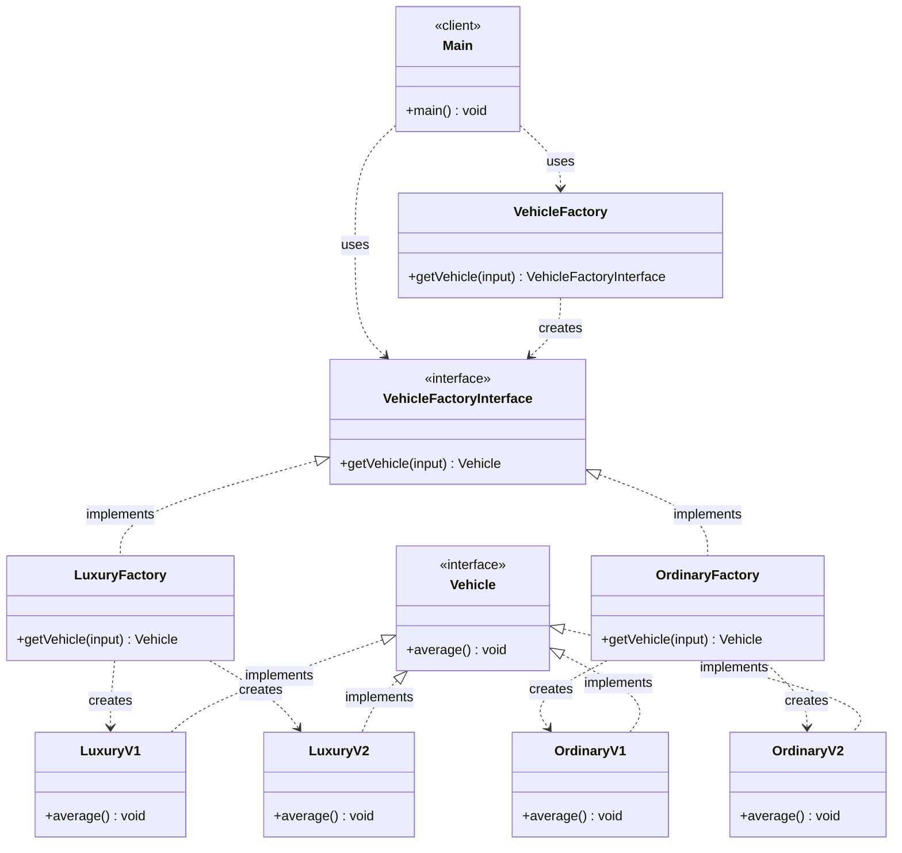

# Abstract Factory Pattern — Class Diagram

`VehicleFactory` is a factory of factories: it returns a concrete `VehicleFactoryInterface` (Luxury / Ordinary), which in turn creates the concrete `Vehicle` of that family.

## Legend

| Arrow | Meaning |
|---|---|
| `..>` | dependency — uses / instantiates |
| `<\|..` | realization — class implements interface |
