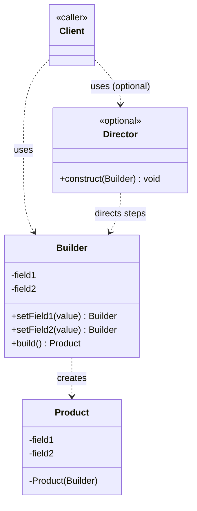

# Builder Design Pattern

Creational pattern: separates the **construction** of a complex object from its **representation**, so the same step-by-step construction process can produce different configurations of that object. See [class-diagram.md](./class-diagram.md).

## What it does

- Builds an object **incrementally**, one field/part at a time, instead of via one giant constructor.
- Hides the object's internal representation and assembly steps from the client — the client just calls setter-style methods, then `build()`.
- Produces a **fully-formed, often immutable** final object only at the end, so the object is never seen in a partially-constructed state.
- Optionally supports a `Director` — a class that encapsulates a *fixed sequence* of builder calls for a known "recipe" (e.g. `buildSportsCar()`, `buildSUV()`), so client code doesn't need to know the steps itself.

## When to use

- The object has **many fields**, most of which are **optional**, and a telescoping constructor (`Foo(a)`, `Foo(a,b)`, `Foo(a,b,c)`...) would be unreadable or error-prone.
- You want construction code to read like a **sentence** (fluent API) instead of a wall of positional arguments.
- You need to build the **same type of object in different configurations/representations** (e.g. a `Document` built as HTML vs. PDF vs. plain text) using a shared construction process.
- The object must be **immutable** once created, but has several optional attributes set at different times.
- You want to validate the full set of parameters **once**, right before the object is created, rather than scattered across multiple constructors.

## When NOT to use

- The object has few fields, or all fields are required — a normal constructor (or static factory method) is simpler.
- You don't need step-by-step assembly — a Factory Method or plain `new` is enough.

## How to use (small example)

```java
// Product
class Pizza {
    private final String size;
    private final boolean cheese;
    private final boolean pepperoni;

    private Pizza(Builder b) {
        this.size = b.size;
        this.cheese = b.cheese;
        this.pepperoni = b.pepperoni;
    }

    // Builder
    static class Builder {
        private String size = "medium";   // default
        private boolean cheese;
        private boolean pepperoni;

        Builder size(String size)      { this.size = size; return this; }
        Builder addCheese()            { this.cheese = true; return this; }
        Builder addPepperoni()         { this.pepperoni = true; return this; }

        Pizza build() { return new Pizza(this); }
    }
}

// Client
Pizza pizza = new Pizza.Builder()
        .size("large")
        .addCheese()
        .addPepperoni()
        .build();
```

Key idiom: builder setters return `this` so calls can be **chained fluently**, and `build()` is the single point where the final immutable object is created.

## Diagram



```
Client -> Builder.setField1(x) -> Builder
Client -> Builder.setField2(y) -> Builder
Client -> Builder.build() -> new Product(builder) -> Product
```

## Roles (GoF)

| Role | Responsibility |
|---|---|
| **Product** | The complex object being built |
| **Builder** | Interface/class declaring construction steps + `build()` |
| **ConcreteBuilder** | Implements the steps, assembles a specific representation |
| **Director** *(optional)* | Runs the builder through a fixed, known sequence of steps |

## Builder vs. look-alikes

| Pattern | Intent |
|---|---|
| **Builder** | Step-by-step construction of one complex object, hiding intermediate state |
| **Factory Method** | One call, one step, delegates *which subclass* to instantiate |
| **Abstract Factory** | Creates **families** of related objects, no step-by-step assembly |
| **Prototype** | Creates new objects by **cloning** an existing instance |

## Real-world examples

- `java.lang.StringBuilder` / `StringBuffer`
- `java.util.stream.Stream.Builder`
- Lombok's `@Builder` annotation (generates this exact pattern)
- `AlertDialog.Builder` (Android)
- `OkHttpClient.Builder`, `Retrofit.Builder`
