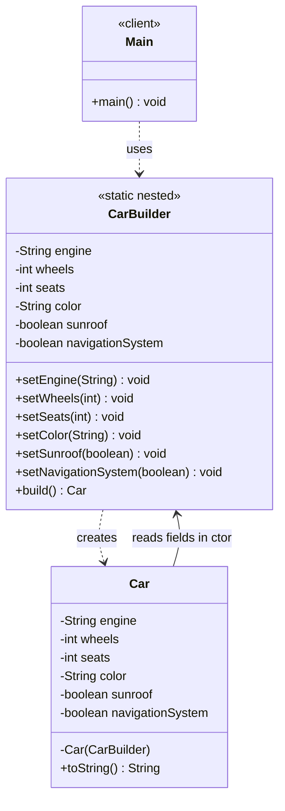

# Builder Design Pattern — Class Diagram

`CarBuilder` is a **static nested class** inside `Car`. It collects parts step-by-step (with defaults for optional ones) and produces an immutable `Car` via `build()`.

## Legend

| Arrow | Meaning |
|---|---|
| `..>` | dependency — uses / instantiates |
| `-->` | association — holds a reference to |

`CarBuilder` is nested inside `Car` (`Car.CarBuilder`) — not shown as a separate relation, just a Java nesting detail.
