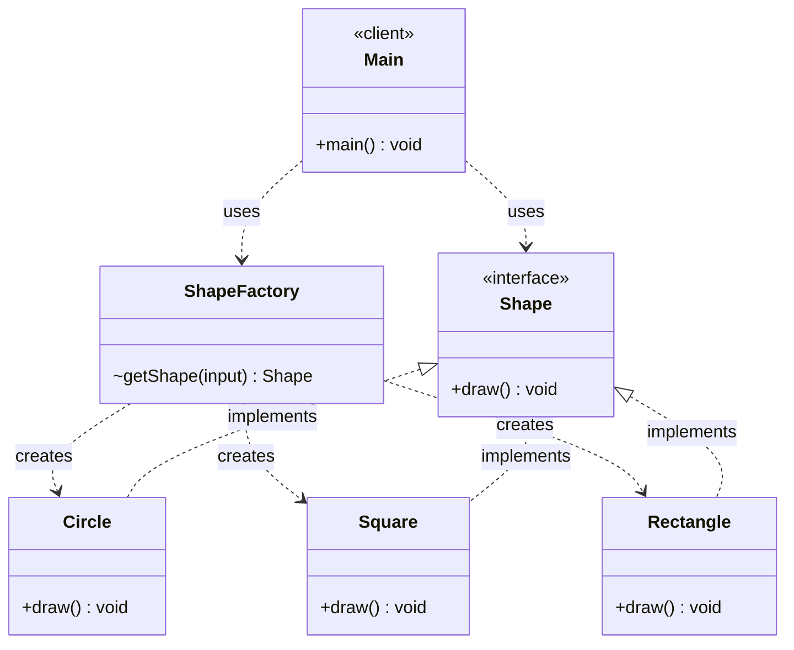

# Factory Pattern — Class Diagram

`ShapeFactory` hides object creation: the client asks for a shape by name and gets back the `Shape` interface.

## Legend

| Arrow | Meaning |
|---|---|
| `..>` | dependency — uses / instantiates |
| `<\|..` | realization — class implements interface |
