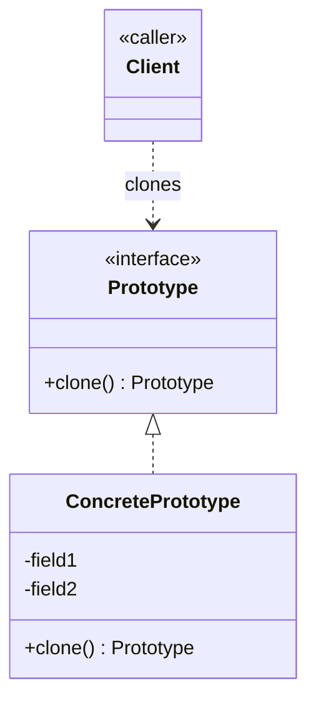

# Prototype Design Pattern

Creational pattern: creates new objects by **copying (cloning) an existing instance** rather than instantiating a class from scratch. See [class-diagram.md](./class-diagram.md).

## What it does

- Declares a `clone()` method that returns a **copy of the calling instance**, with the same runtime type and field values.
- The client obtains a new object by cloning a "prototype" instance, instead of calling `new SomeClass(...)` and knowing its concrete class.
- Supports **shallow copy** (default, field-by-field copy — shared references for objects/arrays) and **deep copy** (explicitly clone nested mutable objects/arrays too).
- Useful when object creation is expensive (DB call, network fetch, heavy computation) — clone a pre-built prototype instead of rebuilding from scratch.

## When to use

- Creating an object is **costly or complex** (expensive constructor, resource-heavy setup) and you already have a similar instance to copy.
- You need many objects that are **variations of a common baseline** (e.g. game entities spawned from a template, with a few fields tweaked after cloning).
- The client shouldn't need to know the **concrete class** of the object it's creating — it just clones whatever prototype it was handed.
- You want to avoid a large hierarchy of factory subclasses just to produce slightly different configurations of an object.

## When NOT to use

- The object is cheap to construct and has few fields — a plain constructor is simpler and clearer.
- The object graph is complex/cyclic, making deep cloning error-prone — a Builder or Factory may be safer.
- `clone()` semantics in the language are subtle/footgun-prone (e.g. Java's `Object.clone()`, which needs care with `CloneNotSupportedException` and shallow-vs-deep copy) — a copy constructor can be a clearer alternative.

## How to use (small example)

```java
// Prototype
abstract class Shape implements Cloneable {
    int x, y;
    abstract void draw();

    @Override
    public Shape clone() {
        try {
            return (Shape) super.clone();   // shallow copy
        } catch (CloneNotSupportedException e) {
            throw new AssertionError(e);
        }
    }
}

// ConcretePrototype
class Circle extends Shape {
    int radius;
    void draw() { System.out.println("Circle r=" + radius + " at (" + x + "," + y + ")"); }
}

// Client
Circle template = new Circle();
template.radius = 10;
template.x = 0; template.y = 0;

Circle copy = (Circle) template.clone();
copy.x = 50;   // tweak only what differs
copy.draw();
```

Key idiom: `clone()` returns a new object with copied state; the client mutates only the fields that should differ, instead of re-specifying everything.

## Diagram



```
Client -> prototype.clone() -> ConcretePrototype (copy) -> Client
Client -> copy.setField(x)   // tweak the copy
```

## Roles (GoF)

| Role | Responsibility |
|---|---|
| **Prototype** | Declares the `clone()` contract (interface or `Cloneable`) |
| **ConcretePrototype** | Implements `clone()`, returning a copy of itself |
| **Client** | Creates new objects by asking a prototype to clone itself |

## Prototype vs. look-alikes

| Pattern | Intent |
|---|---|
| **Prototype** | Creates new objects by **cloning** an existing instance |
| **Builder** | Step-by-step construction of one complex object, hiding intermediate state |
| **Factory Method** | One call, one step, delegates *which subclass* to instantiate — always builds fresh |
| **Abstract Factory** | Creates **families** of related objects, no cloning involved |

## Real-world examples

- `java.lang.Object.clone()` / `Cloneable` marker interface
- `java.util.ArrayList.clone()`, `HashMap.clone()` (shallow-copy collections)
- JavaScript's `Object.assign({}, obj)` / spread `{...obj}` and `structuredClone()`
- Java's `BeanUtils.cloneBean()` / Apache Commons `SerializationUtils.clone()` for deep copies
