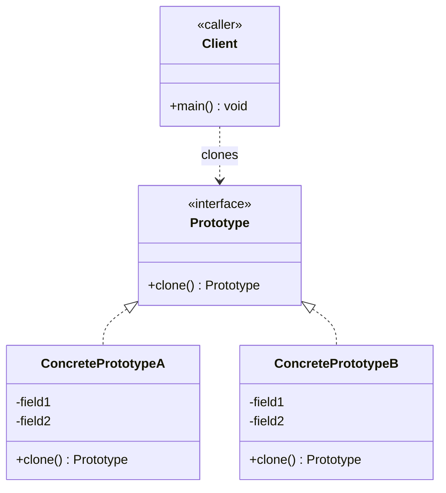

# Prototype Design Pattern — Class Diagram

A `Client` asks an existing `ConcretePrototype` instance to `clone()` itself instead of constructing a new one with `new`.

## Legend

| Arrow | Meaning |
|---|---|
| `<\|..` | realization — implements the `Prototype` interface/contract |
| `..>` | dependency — uses / clones |

In Java, `Prototype` is typically `java.lang.Cloneable` (a marker interface) plus an overridden `clone()`, rather than a hand-rolled interface — but the shape is the same.
