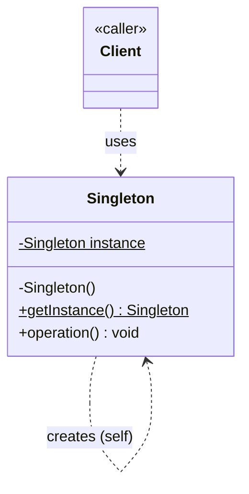

# Singleton Design Pattern — Class Diagram

Ensures a class has **exactly one instance** and provides a global point of access to it.

## Legend

| Arrow | Meaning |
|---|---|
| `..>` | dependency — uses / instantiates |
| `$` | static member (class-level, per UML/Mermaid convention) |

`Singleton()` is **private**, so only `Singleton` itself can construct an instance — enforced entirely inside `getInstance()`.
