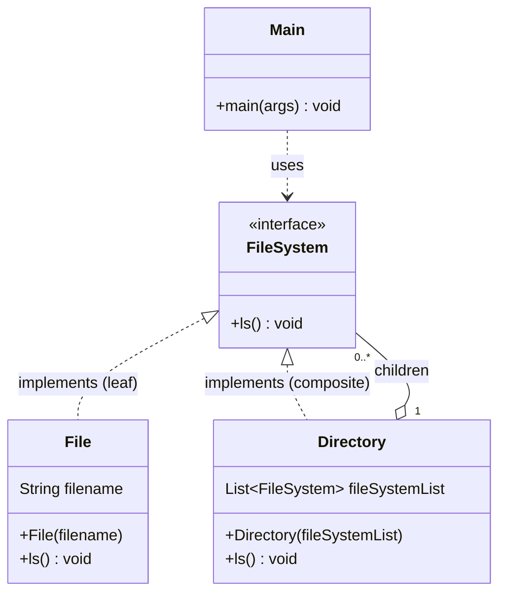

# File System — Class Diagram

Composite pattern: `File` is the leaf, `Directory` is the composite, both are `FileSystem`.

The key relationship is `Directory o-- FileSystem`: a directory holds the *interface*, so it can contain files or other directories, which gives the recursive tree.
