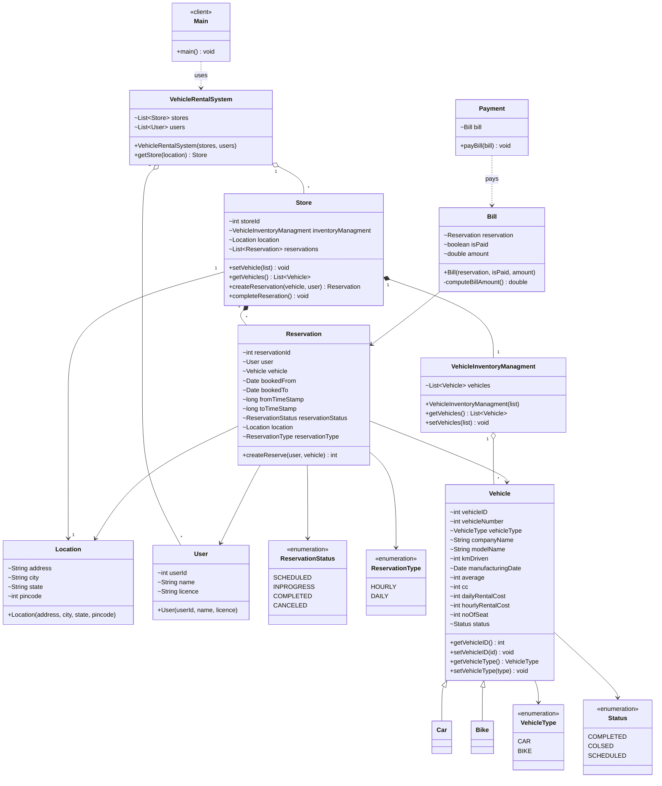

# Car Rental System — Class Diagram

`VehicleRentalSystem` holds stores and users. Each `Store` has a location, a vehicle inventory and its reservations. A `Reservation` links a `User` to a `Vehicle`, a `Bill` is raised for the reservation, and a `Payment` settles the bill.

> Note: in the current code `VehicleInventoryManagment` also `extends Vehicle`. That looks like a mistake (an inventory *has* vehicles, it *is not* one), so the diagram leaves it out.

## Legend

| Arrow | Meaning |
|---|---|
| `..>` | dependency — uses |
| `-->` | association — field reference |
| `o--` | aggregation — holds a collection it did not create |
| `*--` | composition — owned and created by the container |
| `<\|--` | inheritance — extends class |
