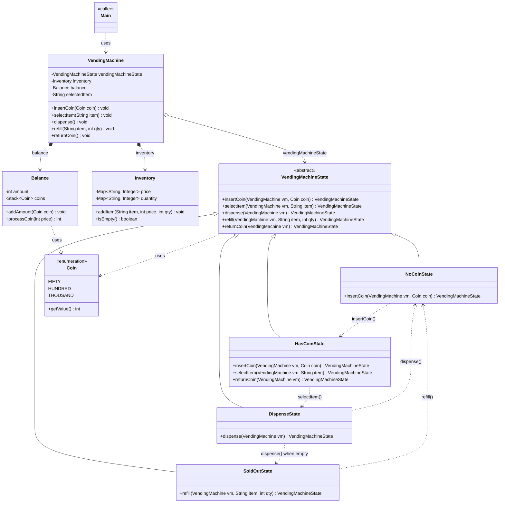
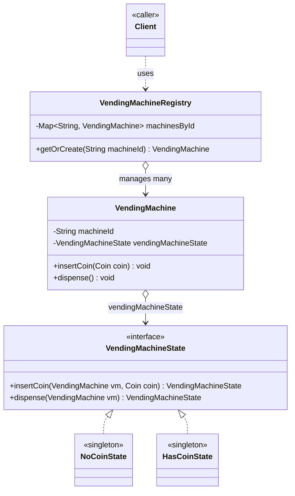

# Vending Machine — Class Diagram

`VendingMachine` (the `Context`) holds a reference to the current `VendingMachineState` and delegates every operation to it. Each concrete state (`NoCoinState`, `HasCoinState`, `DispenseState`, `SoldOutState`) implements only the operations valid for that state and returns the next state — `VendingMachine` never branches on "if state == X".

## Legend

| Arrow | Meaning |
|---|---|
| `<\|--` | inheritance — extends an abstract class (parent listed first) |
| `o-->` | aggregation — `VendingMachine` holds a `VendingMachineState` reference, swapped on every transition |
| `*-->` | composition — `VendingMachine` owns and creates its `Inventory`/`Balance`, they don't outlive it |
| `..>` | dependency — uses, reads from, or transitions to |

The abstract `VendingMachineState` is named first in each inheritance relation (`VendingMachineState <|-- NoCoinState`) so Mermaid ranks it above its concrete states in the `direction TB` layout, matching standard UML.

## Scaling: many instances

A single `VendingMachine` with one mutable `vendingMachineState` field is fine for one physical machine, but a fleet of machines (or one shared transaction service handling many machines at once) needs each machine's state to be independent and looked up by id instead of hardcoded as one instance:

Each `ConcreteState` becomes a stateless singleton (safe to share since it holds no per-machine data — all machine-specific data lives on `VendingMachine`/`Inventory`/`Balance`), and `VendingMachineRegistry` looks up or creates the right `VendingMachine` by `machineId` instead of the program holding one hardcoded instance.
