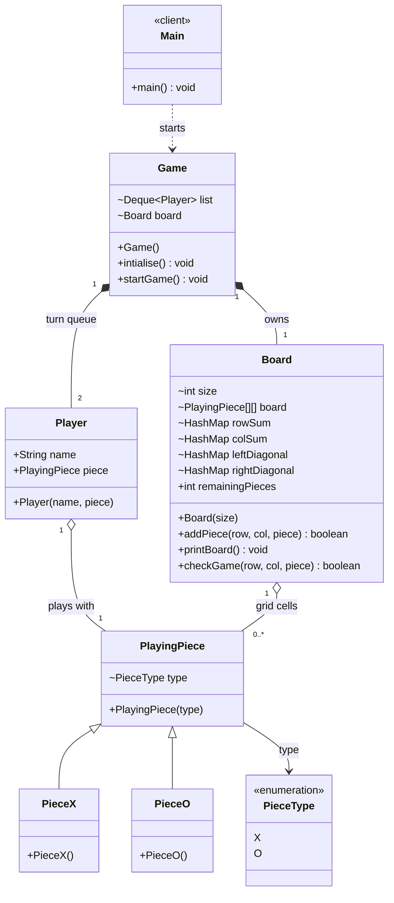

# Tic Tac Toe — Class Diagram

`Game` runs the turn loop over a deque of `Player`s. `Board` stores the grid and keeps per-row/column/diagonal counts keyed by `(index, PieceType)`, so `checkGame()` is O(1).

## Legend

| Arrow | Meaning |
|---|---|
| `..>` | dependency — uses |
| `*--` | composition — created and owned by `Game.intialise()` |
| `o--` | aggregation — holds references to pieces |
| `<\|--` | inheritance — extends class |
| `-->` | association — field reference |
