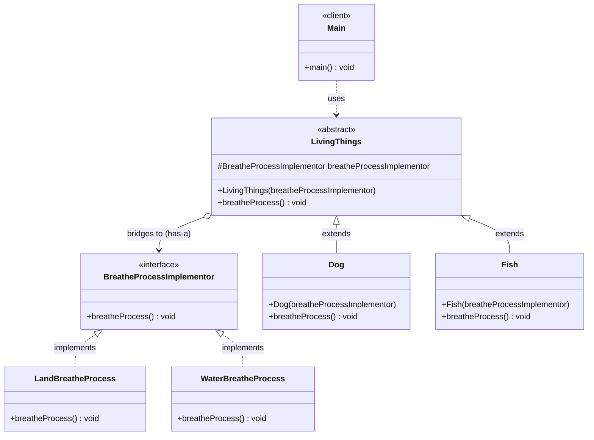
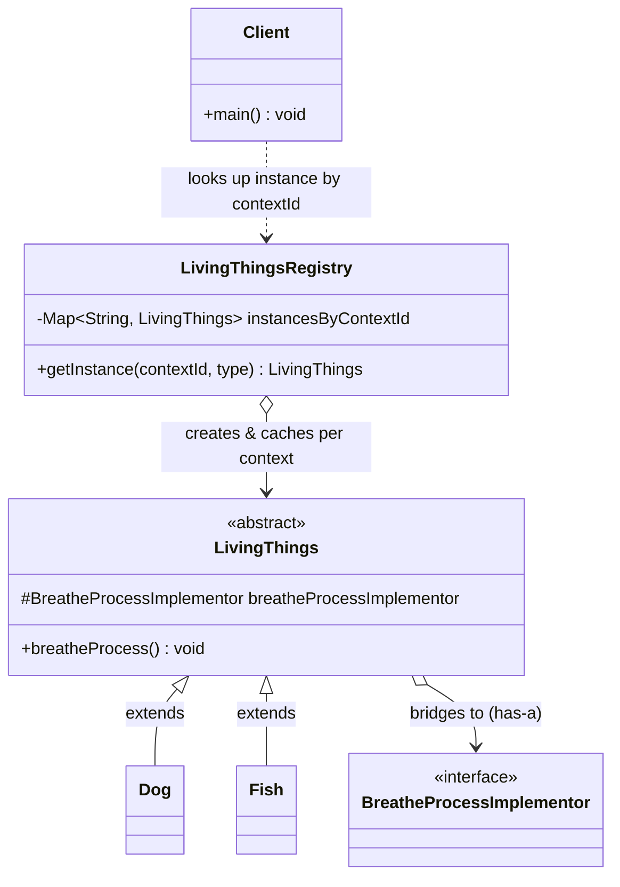

# Bridge Design Pattern — Class Diagram

`LivingThings` (abstraction) holds a `BreatheProcessImplementor` reference instead of implementing breathing itself; `Dog`/`Fish` refine the abstraction while `LandBreatheProcess`/`WaterBreatheProcess` provide the actual breathing implementations — the two hierarchies vary independently.

## Legend

| Arrow | Meaning |
|---|---|
| `..>` | dependency — client uses the abstraction only |
| `<\|..` | realization — class implements interface |
| `<\|--` | inheritance — class extends abstract class |
| `o-->` | aggregation — abstraction holds the implementor (injected via constructor) |

Parent-first layout note: `BreatheProcessImplementor <|.. LandBreatheProcess` and `LivingThings <|-- Dog` are both written parent-first so the interface/abstract class renders above its implementers/subclasses.

## Scaling: many instances

A single `LivingThings` subclass wired to one implementor works for a single demo. When many concurrent contexts each need their own abstraction/implementor pairing (e.g. per-request or per-tenant), move to a registry keyed by context id instead of constructing pairs ad hoc.

