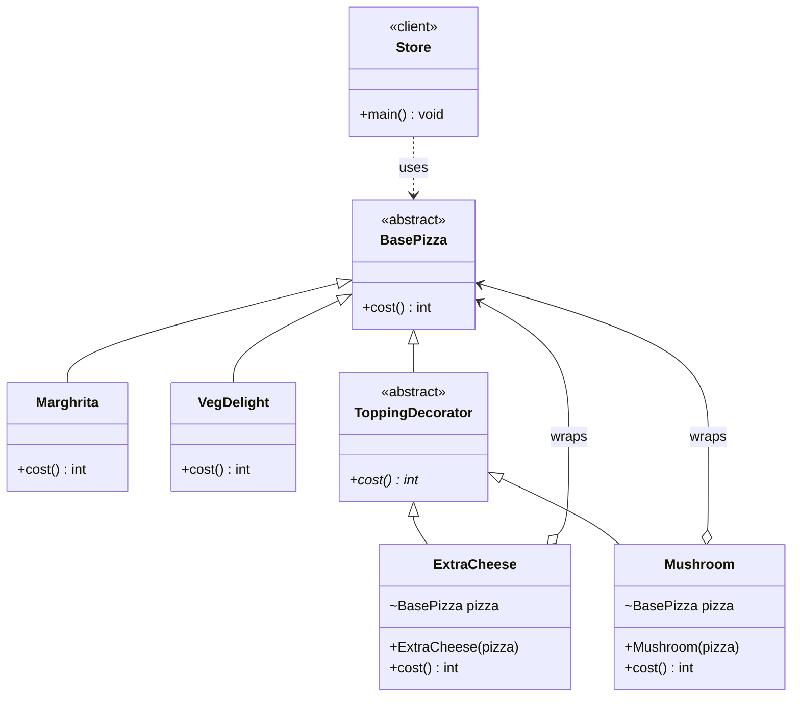

# Decorator Pattern — Class Diagram

A `ToppingDecorator` **is-a** `BasePizza` and **has-a** `BasePizza`, so toppings can wrap a pizza (or another topping) and add to its `cost()`.

Example from `Store`: `new ExtraCheese(new Mushroom(new VegDelight()))` → 200 + 15 + 10 = **225**.

## Legend

| Arrow | Meaning |
|---|---|
| `..>` | dependency — client uses the pizza |
| `<\|--` | inheritance — extends class |
| `o-->` | aggregation — decorator holds the wrapped pizza (injected via constructor) |
