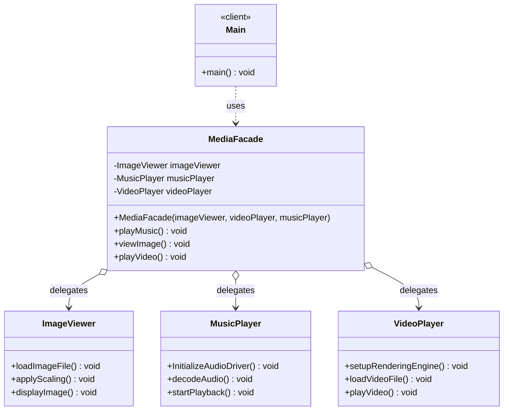
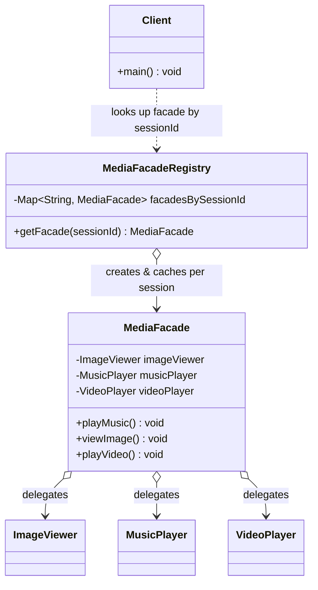

# Facade Design Pattern — Class Diagram

`MediaFacade` sits in front of three independent subsystem classes (`ImageViewer`, `MusicPlayer`, `VideoPlayer`) and exposes one simple call per use case, hiding each subsystem's multi-step sequence.

## Legend

| Arrow | Meaning |
|---|---|
| `..>` | dependency — client only ever calls the facade |
| `o-->` | aggregation — facade holds each subsystem (injected via constructor) |

Parent-first layout note: not applicable here (no inheritance/realization edges) — the facade is placed above the subsystems it delegates to so the diagram reads client → facade → subsystems, top to bottom.

## Scaling: many instances

A single `MediaFacade` field per subsystem works for one session. When many concurrent sessions each need their own wired-up subsystem set, move to a registry keyed by session/context id instead of one shared facade instance.

