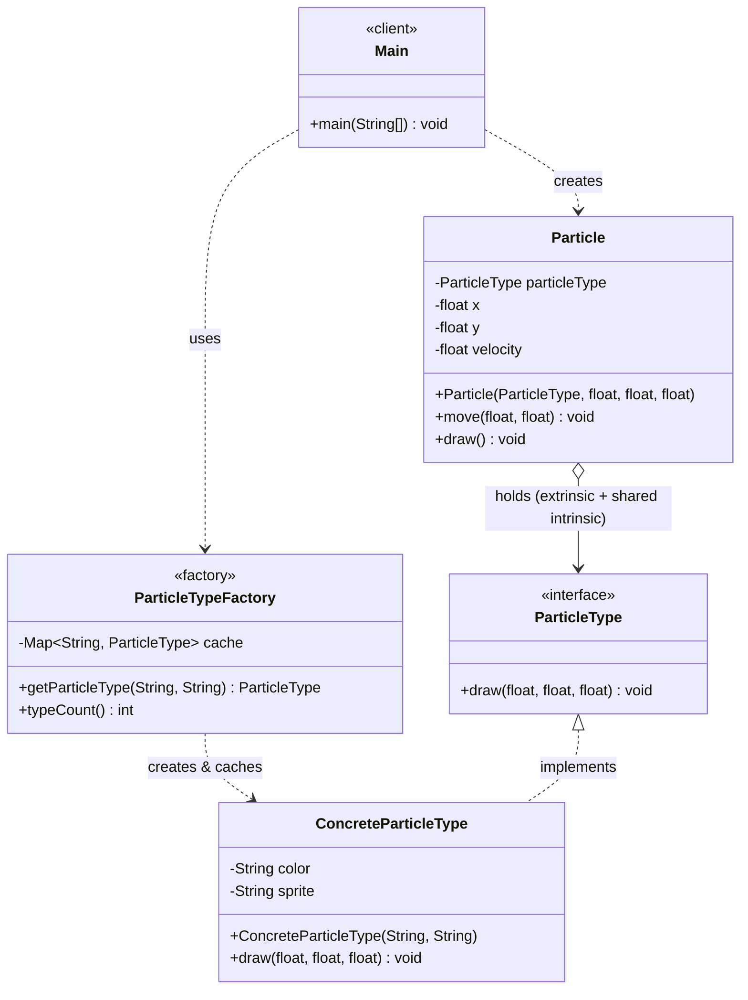
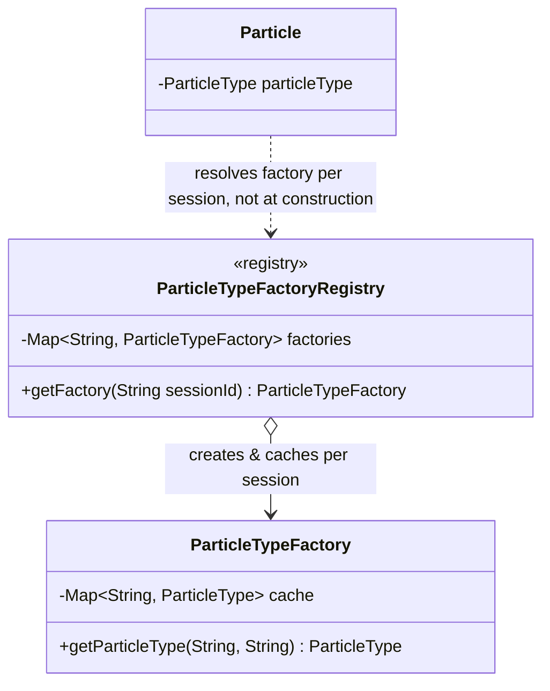

# Flyweight Design Pattern — Class Diagram

`ParticleTypeFactory` caches and reuses `ConcreteParticleType` flyweights (intrinsic state: color, sprite); each `Particle` holds its own extrinsic state (x, y, velocity) plus a reference to a shared `ParticleType`.

## Legend

| Arrow | Meaning |
|---|---|
| `..>` | dependency — uses / instantiates |
| `<\|..` | realization — class implements interface |
| `o-->` | aggregation — context holds a shared flyweight reference |

Parent-first ordering (`ParticleType <|.. ConcreteParticleType`) keeps the interface ranked above its implementation in the `direction TB` layout.

## Scaling: many instances

A single `ParticleTypeFactory` already handles "many instances" by design — that's the point of the pattern. At LLD-interview scale, the shift is usually to **many concurrent scenes/sessions**, each wanting its own bounded flyweight cache (e.g. per-game-session pooling, or per-tenant caches so one tenant's flyweight variety can't evict another's).

