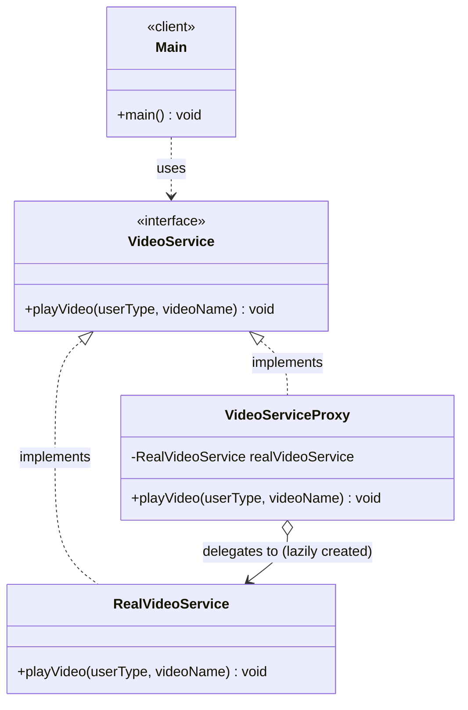
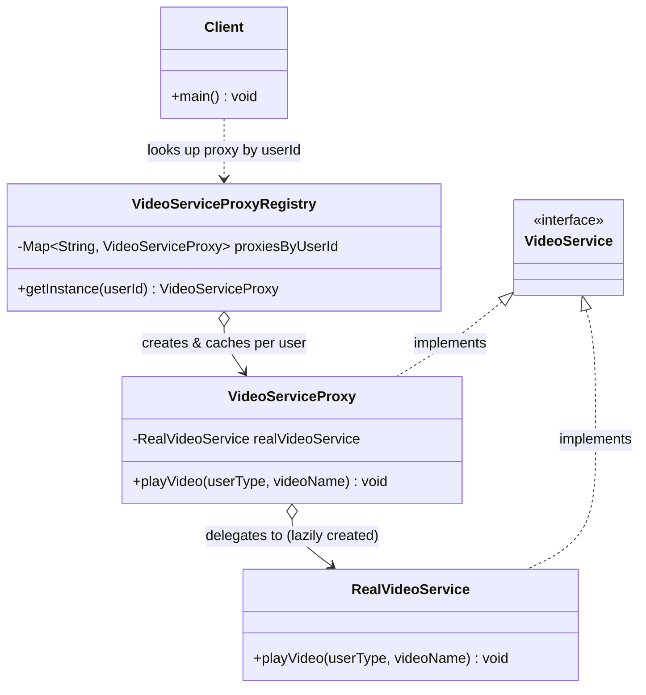

# Proxy Design Pattern — Class Diagram

`VideoServiceProxy` implements the same `VideoService` interface as `RealVideoService`, sits between `Main` and it, enforces access control, and lazily creates the real object only once a call is actually allowed through.

## Legend

| Arrow | Meaning |
|---|---|
| `..>` | dependency — client uses the `VideoService` interface only |
| `<\|..` | realization — class implements interface |
| `o-->` | aggregation — proxy holds the real subject (created lazily, not injected) |

Parent-first layout note: `VideoService <|.. VideoServiceProxy` and `VideoService <|.. RealVideoService` are both written parent-first so the interface renders above its two implementers.

## Scaling: many instances

A single `VideoServiceProxy` holding one lazily-created `RealVideoService` works for one demo run. When many concurrent users/sessions each need their own access check and real-subject lifecycle, move to a registry keyed by context id instead of one shared proxy instance.

